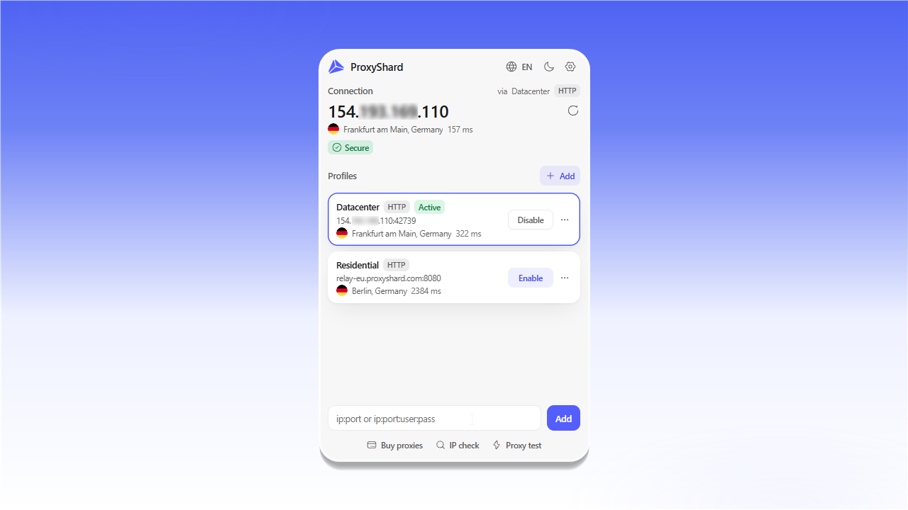
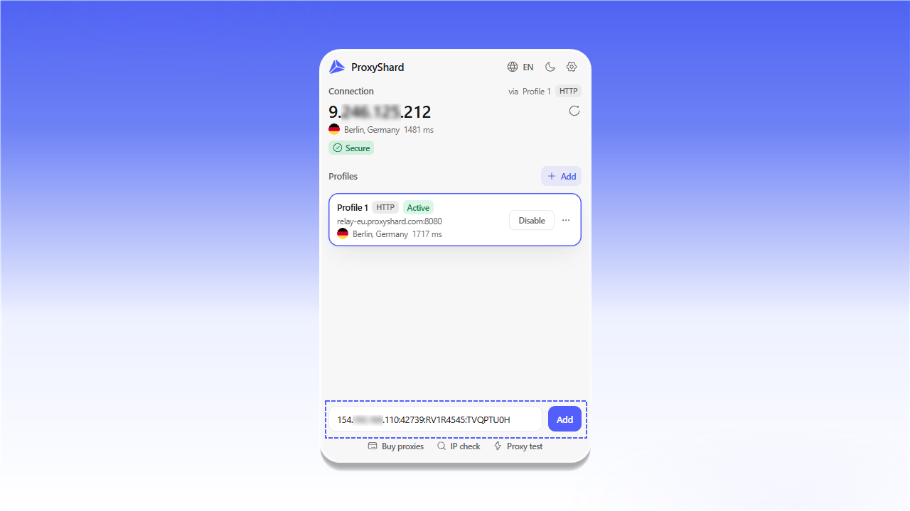
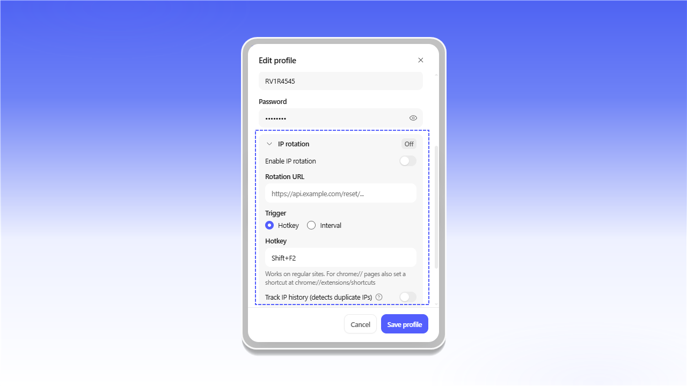
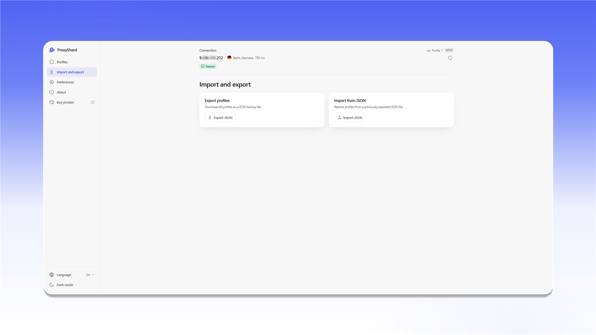

# ProxyShard Extension

<mark style="color:purple;">**ProxyShard – Smart Proxy Manager**</mark> - фірмове розширення ProxyShard для Chrome, Mozilla Firefox і браузерів на Chromium: Edge, Opera, Brave, Yandex та інших. Воно дає змогу додавати, перевіряти й перемикати проксі безпосередньо у браузері.

#### Можливості розширення

* Необмежена кількість проксі-профілів
* Підтримка HTTP / HTTPS у всіх сумісних браузерах
* Підтримка SOCKS5 у Mozilla Firefox
* Перевірка з'єднання, IP-адреси, країни та затримки
* Ротація IP мобільного проксі за інтервалом або сполученням клавіш
* Правила маршрутизації та автоматичне перемикання профілів за доменами
* Захист від витоку WebRTC і перевірка TCP-відбитка через p0f
* Імпорт та експорт профілів
* Інтерфейс англійською, російською, українською та китайською мовами

<figure>
  <picture>
    <source srcset="../.gitbook/assets/proxyshard-extension-popup-overview_black.png" media="(prefers-color-scheme: dark)">
    
  </picture>
  <figcaption>
Головне вікно розширення зі списком проксі-профілів
</figcaption>
</figure>

## Встановлення розширення

Розширення доступне в офіційних магазинах Chrome Web Store і Firefox Add-ons. Версію з Chrome Web Store також можна встановити в Edge, Opera, Brave та інші браузери на Chromium.

### Chrome, Edge, Opera, Brave, Yandex та інші браузери на Chromium



### Mozilla Firefox



Після встановлення відкрийте меню `Extensions` праворуч від адресного рядка та закріпіть `ProxyShard – Smart Proxy Manager`, натиснувши значок шпильки.

<figure>
  <picture>
    <source srcset="../.gitbook/assets/proxyshard-extension-pin_black.png" media="(prefers-color-scheme: dark)">
    
  </picture>
  <figcaption>
Відкрийте меню Extensions і закріпіть розширення
</figcaption>
</figure>


**Обмеження SOCKS5 у браузерах на Chromium**

Chrome та інші браузери на Chromium не підтримують авторизацію за логіном і паролем для SOCKS5-проксі через розширення Manifest V3.

SOCKS5 можна використовувати лише без облікових даних або з авторизацією за білим списком IP-адрес. Для проксі з логіном і паролем виберіть HTTP / HTTPS.



**SOCKS5 у Mozilla Firefox**

Версія ProxyShard Extension для Mozilla Firefox підтримує SOCKS5 з авторизацією, тому такі профілі можна використовувати безпосередньо.


## Налаштування резидентського проксі

1. Відкрийте замовлення на сторінці [Residential proxy](https://dashboard.proxyshard.com/en/residential-main).
2. Укажіть країну, регіон, тип сесії, протокол та інші параметри, потім натисніть `Generate proxy`.
3. У блоці `Proxy List` виберіть потрібний формат і натисніть `Copy all`.

<figure>
  <picture>
    <source srcset="../.gitbook/assets/proxyshard-extension-residential-generate_black.png" media="(prefers-color-scheme: dark)">
    
  </picture>
  <figcaption>
Налаштування резидентського проксі та блок Proxy List
</figcaption>
</figure>

4. Відкрийте закріплене розширення ProxyShard.
5. Вставте рядок у форматі `ip:port:login:password` у нижнє поле та натисніть `Add`.

<figure>
  <picture>
    <source srcset="../.gitbook/assets/proxyshard-extension-add-proxy-string_black.png" media="(prefers-color-scheme: dark)">
    
  </picture>
  <figcaption>
Вставте рядок підключення та натисніть Add
</figcaption>
</figure>

6. Новий профіль з'явиться у списку. Відкрийте його меню `...`, виберіть `Test connection`, а після успішної перевірки натисніть `Enable`.

<figure>
  <picture>
    <source srcset="../.gitbook/assets/proxyshard-extension-profile-actions_black.png" media="(prefers-color-scheme: dark)">
    
  </picture>
  <figcaption>
Меню перевірки, редагування та видалення профілю
</figcaption>
</figure>

## Налаштування датацентр- або ISP-проксі

1. Відкрийте замовлення датацентр- або ISP-проксі в особистому кабінеті.
2. У блоці `Proxy List` виберіть протокол і формат, потім натисніть `Copy all`.

<figure>
  <picture>
    <source srcset="../.gitbook/assets/proxyshard-extension-datacenter-proxy-list_black.png" media="(prefers-color-scheme: dark)">
    
  </picture>
  <figcaption>
Скопіюйте рядок підключення з блоку Proxy List
</figcaption>
</figure>

3. Відкрийте розширення, вставте рядок у нижнє поле та натисніть `Add`.

<figure>
  <picture>
    <source srcset="../.gitbook/assets/proxyshard-extension-add-datacenter-proxy_black.png" media="(prefers-color-scheme: dark)">
    
  </picture>
  <figcaption>
Додавання датацентр- або ISP-проксі
</figcaption>
</figure>

4. Відкрийте меню `...` нового профілю та виберіть `Test connection`.
5. Якщо перевірка завершилася успішно, натисніть `Enable`. Коли ви вмикаєте інший профіль, поточне з'єднання перемикається автоматично.

<figure>
  <picture>
    <source srcset="../.gitbook/assets/proxyshard-extension-profile-switch_black.png" media="(prefers-color-scheme: dark)">
    
  </picture>
  <figcaption>
Перевірка та ввімкнення нового профілю
</figcaption>
</figure>

## Ротація IP мобільного проксі

Відкрийте меню `...` профілю, натисніть `Edit` і розгорніть блок `IP rotation`.

* `Enable IP rotation` вмикає автоматичну зміну IP.
* У `Rotation URL` вставте посилання для зміни IP із замовлення мобільного проксі.
* У `Trigger` виберіть `Hotkey` або `Interval`.
* Для `Hotkey` укажіть сполучення клавіш, наприклад `Shift+F2`. Для внутрішніх сторінок `chrome://` його потрібно окремо призначити на сторінці `chrome://extensions/shortcuts`.
* Для `Interval` укажіть інтервал між запитами на зміну IP.
* `Track IP history (detects duplicate IPs)` відстежує повторне отримання тієї самої IP-адреси.

Натисніть `Save profile`, щоб зберегти налаштування.

<figure>
  <picture>
    <source srcset="../.gitbook/assets/proxyshard-extension-edit-profile-ip-rotation_black.png" media="(prefers-color-scheme: dark)">
    
  </picture>
  <figcaption>
Ротація IP за сполученням клавіш або інтервалом
</figcaption>
</figure>

## Маршрутизація та автоматичне перемикання

У вікні редагування профілю доступні блоки `Domain routing` і `Auto-switch`.

### Domain routing

Цей блок задає правила маршрутизації для окремих доменів.

* `Enable routing rules` вмикає правила.
* `Whitelist` спрямовує через проксі лише вказані домени.
* `Blacklist` виключає вказані домени з проксі-маршрутизації.
* У `Domains` укажіть по одному домену в кожному рядку. Щоб додати піддомени, поставте маску `*.` перед доменом, наприклад `*.google.com`.

### Auto-switch

Функція автоматично вмикає вибраний профіль під час відкриття вказаних сайтів.

* `Enable auto-switch` вмикає автоматичне перемикання.
* У `Activate on these domains` укажіть по одному домену в кожному рядку, наприклад `example.com` або `*.work-site.com`.

Натисніть `Save profile`, щоб зберегти зміни, або `Cancel`, щоб закрити вікно без збереження.

<figure>
  <picture>
    <source srcset="../.gitbook/assets/proxyshard-extension-edit-profile-routing_black.png" media="(prefers-color-scheme: dark)">
    
  </picture>
  <figcaption>
Маршрутизація за доменами та автоматичне перемикання профілю
</figcaption>
</figure>

## Ручне додавання профілю

1. Натисніть значок шестерні в головному вікні розширення та відкрийте розділ `Profiles`.
2. Натисніть `+ Add profile` і виберіть вкладку `Manual`.
3. Заповніть поля:
   * `Name` - назва профілю;
   * `Type` - тип підключення;
   * `Host` і `Port` - адреса та порт проксі-сервера;
   * `Bypass list` - адреси, які мають відкриватися безпосередньо, по одній у рядку;
   * `Username` і `Password` - дані авторизації.
4. За потреби налаштуйте `IP rotation`, `Domain routing` і `Auto-switch domains`.
5. Натисніть `Save profile`.

Щоб швидко додати готовий рядок проксі, скористайтеся вкладкою `Quick paste`.

<figure>
  <picture>
    <source srcset="../.gitbook/assets/proxyshard-extension-options-add-profile_black.png" media="(prefers-color-scheme: dark)">
    
  </picture>
  <figcaption>
Форма Add profile на вкладці Manual
</figcaption>
</figure>

## Імпорт та експорт профілів

Розділ `Import and export` дає змогу створити резервну копію профілів і відновити її за потреби.

* `Export profiles` зберігає всі профілі у JSON-файл. Натисніть `Export JSON` і збережіть файл у безпечному місці.
* `Import from JSON` відновлює профілі з раніше експортованого файлу. Натисніть `Import JSON` і виберіть резервну копію.


Файл резервної копії може містити адреси проксі та дані авторизації. Не передавайте його стороннім особам.


<figure>
  <picture>
    <source srcset="../.gitbook/assets/proxyshard-extension-options-import-export_black.png" media="(prefers-color-scheme: dark)">
    
  </picture>
  <figcaption>
Резервне копіювання та відновлення профілів
</figcaption>
</figure>

## Додаткові налаштування

У розділі `Preferences` доступні такі параметри:

* `Show IP widget in popup` показує поточну IP-адресу та локацію у верхній частині вікна розширення.
* `Show badge on the toolbar icon` показує індикатор стану на значку розширення.
* `Context menu` додає перемикання проксі-профілів до контекстного меню браузера.
* `Auto-switch by domain` дозволяє автоматично вмикати профіль для налаштованих доменів.
* `WebRTC leak protection` допомагає захистити реальну IP-адресу від витоку через WebRTC. Коли захист увімкнено, деякі сервіси на основі WebRTC можуть працювати некоректно. Докладніше читайте в розділі [UDP і WebRTC](about-udp/README.md).
* `Proxy fingerprint check (p0f)` порівнює операційну систему з User-Agent із TCP-відбитком. Невідповідність може вказувати на використання проксі. Докладніше читайте в розділі [Підміна відбитка ОС через p0f](p0f-spoofing.md).
* `IP checker` дає змогу вибрати сервіс для визначення IP-адреси та локації. У режимі `Auto (fallback)` розширення послідовно перевіряє доступні сервіси, доки один із них не відповість.

Після зміни параметрів натисніть `Save preferences`.

<figure>
  <picture>
    <source srcset="../.gitbook/assets/proxyshard-extension-options-preferences_black.png" media="(prefers-color-scheme: dark)">
    
  </picture>
  <figcaption>
Додаткові налаштування розширення
</figcaption>
</figure>


ProxyShard Extension готове до роботи. Вмикати та перемикати збережені профілі можна з головного вікна розширення.

