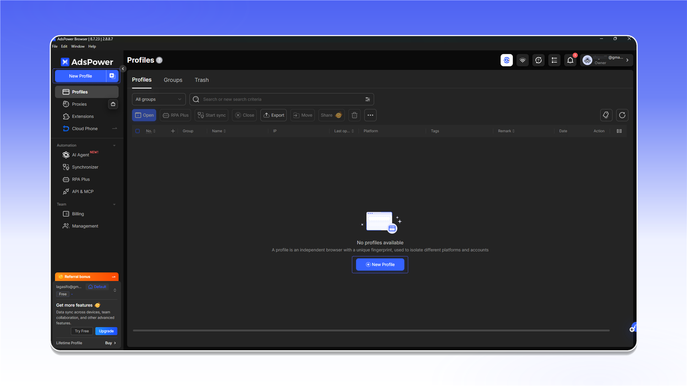
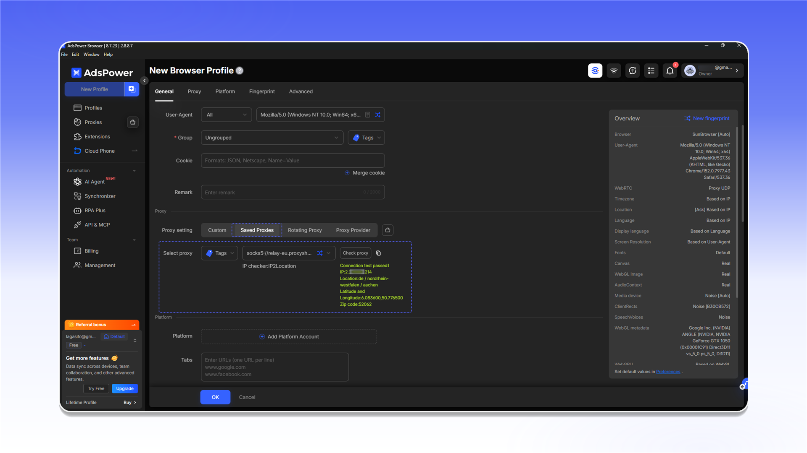

# AdsPower


AdsPower не підтримує UDP-проксі. Для завдань із UDP використовуйте [Vision Browser](vision-browser.md).


## Додавання проксі

Відкрийте розділ `Proxies` і натисніть `Add Proxy`.

<figure>
  <picture>
    <source srcset="../../.gitbook/assets/adspower-proxies-add-proxy_black.png" media="(prefers-color-scheme: dark)">
    
  </picture>
</figure>

1. Скопіюйте рядок підключення з `Proxy List` потрібного замовлення та вставте його у форму.
2. Натисніть `Check proxy`.
3. Після успішної перевірки натисніть `OK`.

<figure>
  <picture>
    <source srcset="../../.gitbook/assets/adspower-add-proxy-form_black.png" media="(prefers-color-scheme: dark)">
    
  </picture>
</figure>


Розташування даних підключення описано в [загальній інструкції](../getting-started.md).


Якщо перевірка не проходить, перевірте логін, пароль і протокол. Також протестуйте з'єднання через [Proxy Tester](../../our-products/proxy-tester.md).

<figure>
  <picture>
    <source srcset="../../.gitbook/assets/adspower-proxy-tester-result_black.png" media="(prefers-color-scheme: dark)">
    
  </picture>
</figure>

## Призначення проксі профілю

Відкрийте `Profiles` і натисніть `New Profile`.

<figure>
  <picture>
    <source srcset="../../.gitbook/assets/adspower-profiles-new-profile_black.png" media="(prefers-color-scheme: dark)">
    
  </picture>
</figure>

У налаштуваннях профілю виберіть доданий сервер у `Saved Proxies`, перевірте його та збережіть профіль.

<figure>
  <picture>
    <source srcset="../../.gitbook/assets/adspower-new-profile-saved-proxy_black.png" media="(prefers-color-scheme: dark)">
    
  </picture>
</figure>
