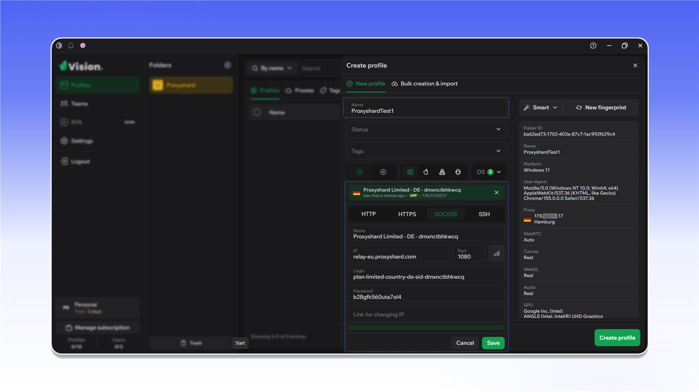
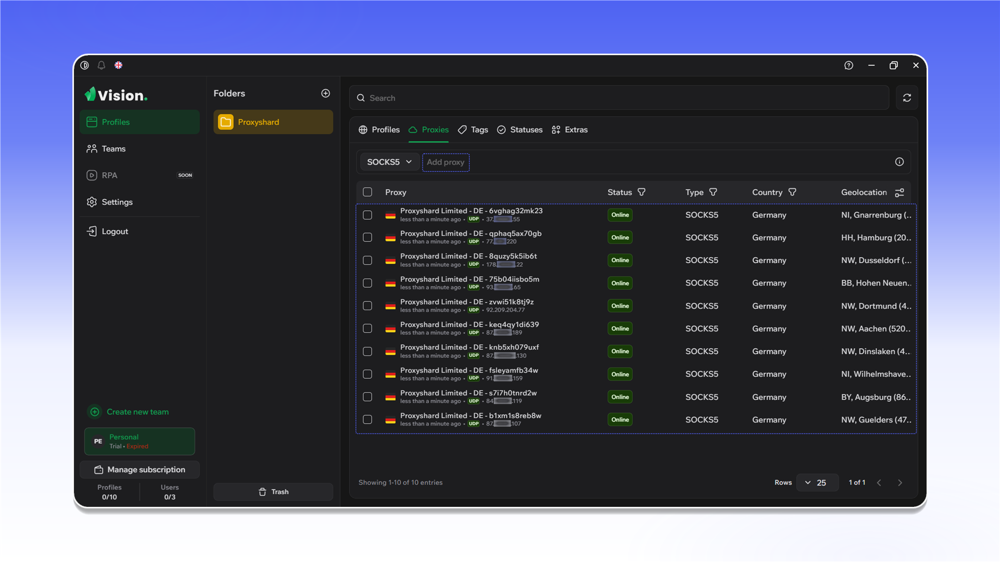

# Vision Browser


Vision Browser підтримує TCP- і UDP-трафік через SOCKS5-проксі.


## Встановлення та реєстрація

Відкрийте [сайт Vision Browser](https://browser.vision/r/ecf2408f-02de-4e4f-bc24-be368ac32325), завантажте програму та встановіть її.

<figure>
  <picture>
    <source srcset="../../.gitbook/assets/vision-website-download_black.png" media="(prefers-color-scheme: dark)">
    
  </picture>
</figure>

Створіть обліковий запис. Ці дані потрібні для входу в програму.

<figure>
  <picture>
    <source srcset="../../.gitbook/assets/vision-sign-up_black.png" media="(prefers-color-scheme: dark)">
    
  </picture>
</figure>

Під час оплати тарифу можна використати промокод `PROXYSHARD` зі знижкою 20%.

<figure>
  <picture>
    <source srcset="../../.gitbook/assets/vision-plan-promo-code_black.png" media="(prefers-color-scheme: dark)">
    
  </picture>
</figure>

## Створення першого профілю

1. Відкрийте `Profiles`.
2. Перейдіть у `Folders` і натисніть `Create folder`.

<figure>
  <picture>
    <source srcset="../../.gitbook/assets/vision-folders-create_black.png" media="(prefers-color-scheme: dark)">
    
  </picture>
</figure>

Введіть назву папки та збережіть її.

<figure>
  <picture>
    <source srcset="../../.gitbook/assets/vision-folder-create-form_black.png" media="(prefers-color-scheme: dark)">
    
  </picture>
</figure>

У створеній папці натисніть `Create profile`.

<figure>
  <picture>
    <source srcset="../../.gitbook/assets/vision-profiles-create-profile_black.png" media="(prefers-color-scheme: dark)">
    
  </picture>
</figure>

У панелі ShardX згенеруйте один проксі у форматі SOCKS5 і скопіюйте дані підключення.

<figure>
  <picture>
    <source srcset="../../.gitbook/assets/vision-residential-generate-single_black.png" media="(prefers-color-scheme: dark)">
    
  </picture>
</figure>

У налаштуваннях профілю Vision відкрийте вкладку `SOCKS`, введіть дані проксі, перевірте з'єднання та натисніть `Save`.

<figure>
  <picture>
    <source srcset="../../.gitbook/assets/vision-create-profile-socks_black.png" media="(prefers-color-scheme: dark)">
    
  </picture>
</figure>

<figure><figcaption></figcaption></figure>

## Додавання списку проксі

Відкрийте вкладку `Proxies` і натисніть `Add proxy`.

<figure>
  <picture>
    <source srcset="../../.gitbook/assets/vision-proxies-add-proxy_black.png" media="(prefers-color-scheme: dark)">
    
  </picture>
</figure>

У панелі ShardX згенеруйте список проксі у форматі SOCKS5 і скопіюйте його.

<figure>
  <picture>
    <source srcset="../../.gitbook/assets/vision-residential-generate-list_black.png" media="(prefers-color-scheme: dark)">
    
  </picture>
</figure>

Вставте список у поле додавання. Після імпорту переконайтеся, що підключення мають статус `Online`.

<figure>
  <picture>
    <source srcset="../../.gitbook/assets/vision-proxies-imported-list_black.png" media="(prefers-color-scheme: dark)">
    
  </picture>
</figure>

Щоб призначити проксі наявному профілю, натисніть значок у стовпці `Proxy`.

<figure><figcaption></figcaption></figure>

Виберіть `Select proxy`, вкажіть потрібне підключення та перевірте його.

<figure><figcaption></figcaption></figure>

Після збереження проксі з'явиться у рядку профілю.

<figure><figcaption></figcaption></figure>

## Перевірка WebRTC

Запустіть профіль і відкрийте [ShardX IP Checker](https://proxyshard.com/ip-checker). Адреси TCP і WebRTC мають збігатися.

<figure>
  <picture>
    <source srcset="../../.gitbook/assets/vision-webrtc-check_black.png" media="(prefers-color-scheme: dark)">
    
  </picture>
</figure>
