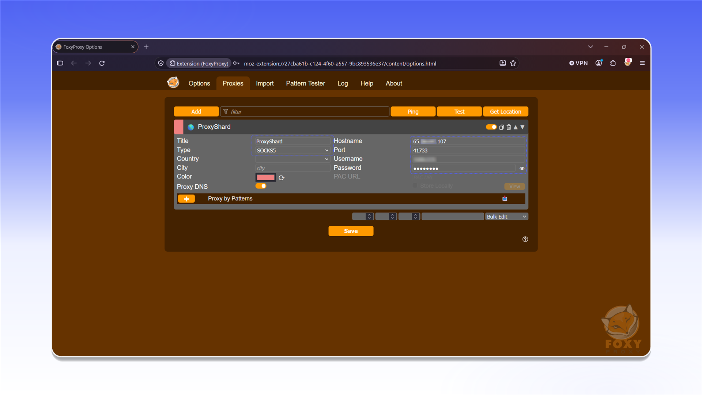

# FoxyProxy

## Встановлення FoxyProxy


FoxyProxy працює лише з TCP-трафіком.


Встановіть [FoxyProxy Standard](https://addons.mozilla.org/firefox/addon/foxyproxy-standard/) із Firefox Add-ons.



<figure>
  <picture>
    <source srcset="../../../.gitbook/assets/foxyproxy-addon-page_black.png" media="(prefers-color-scheme: dark)">
    
  </picture>
</figure>

Після встановлення відкрийте FoxyProxy та перейдіть до налаштувань розширення.

<figure>
  <picture>
    <source srcset="../../../.gitbook/assets/foxyproxy-options-popup-disable_black.png" media="(prefers-color-scheme: dark)">
    
  </picture>
</figure>

## Налаштування проксі

Відкрийте `Proxies` і натисніть `Add`.

<figure>
  <picture>
    <source srcset="../../../.gitbook/assets/foxyproxy-add-proxy-form_black.png" media="(prefers-color-scheme: dark)">
    
  </picture>
</figure>


Формат даних і приклад замовлення описані в розділі [Початок роботи](../../getting-started.md).


Укажіть назву профілю в полі `Title`. Виберіть тип проксі та заповніть поля `Hostname`, `Port`, `Username` і `Password` даними з `Proxy List` вашого замовлення. Натисніть `Save`.

<figure>
  <picture>
    <source srcset="../../../.gitbook/assets/foxyproxy-proxy-config-filled_black.png" media="(prefers-color-scheme: dark)">
    
  </picture>
</figure>

## Підключення

Відкрийте FoxyProxy та виберіть створений профіль.

<figure>
  <picture>
    <source srcset="../../../.gitbook/assets/foxyproxy-options-popup-proxyshard_black.png" media="(prefers-color-scheme: dark)">
    
  </picture>
</figure>

Проксі підключено та готово до роботи в Mozilla Firefox.
