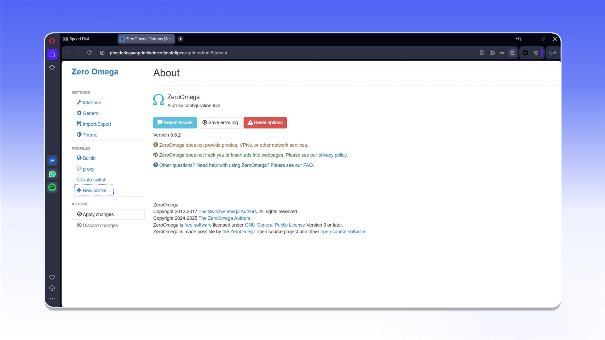
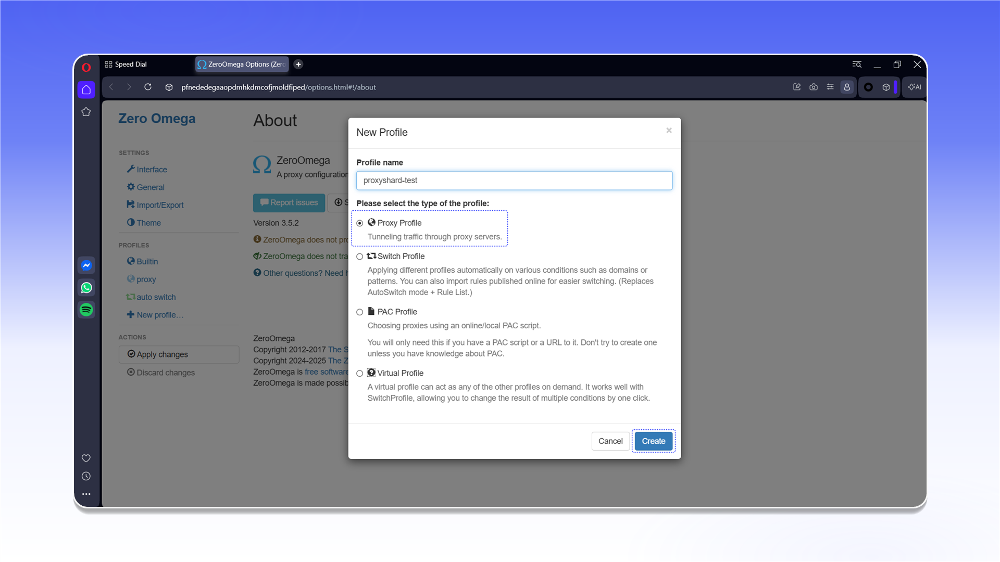
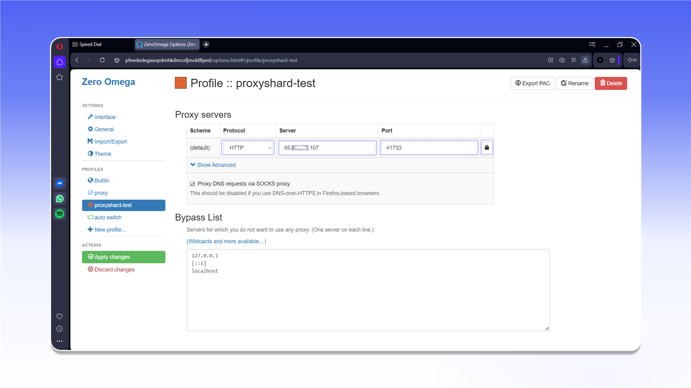
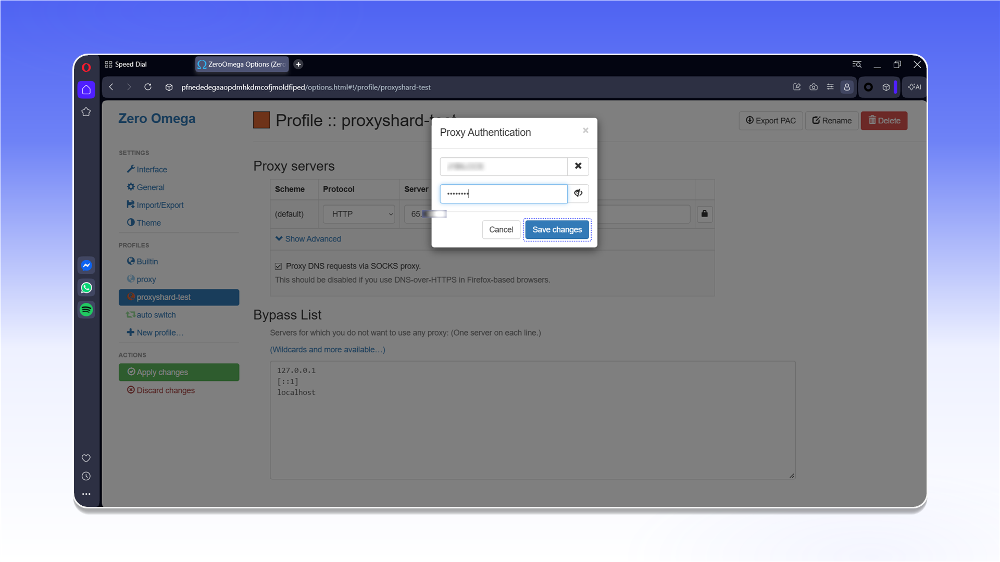
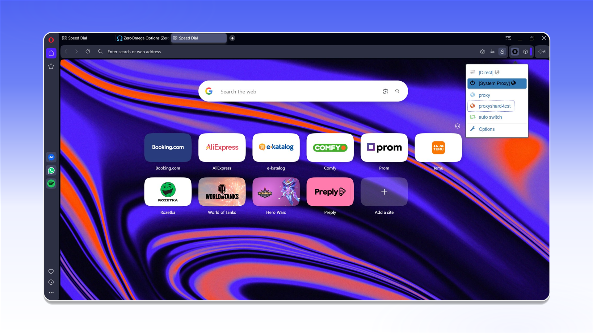

# ZeroOmega

## Встановлення ZeroOmega


ZeroOmega працює лише з TCP-трафіком. Для роботи з UDP використовуйте [Vision Browser](../../antidetect-browsers/vision-browser.md).


Встановіть [ZeroOmega](https://chromewebstore.google.com/detail/pfnededegaaopdmhkdmcofjmoldfiped) із Chrome Web Store.



<figure>
  <picture>
    <source srcset="../../../.gitbook/assets/opera-zeroomega-web-store_black.png" media="(prefers-color-scheme: dark)">
    
  </picture>
</figure>

Після встановлення відкрийте меню розширень і закріпіть ZeroOmega на панелі браузера.

<figure>
  <picture>
    <source srcset="../../../.gitbook/assets/opera-zeroomega-extensions-menu_black.png" media="(prefers-color-scheme: dark)">
    
  </picture>
</figure>

Відкрийте ZeroOmega та виберіть `Options`.

<figure><figcaption></figcaption></figure>

У розділі `Profiles` натисніть `New profile...`.

<figure>
  <picture>
    <source srcset="../../../.gitbook/assets/opera-zeroomega-new-profile_black.png" media="(prefers-color-scheme: dark)">
    
  </picture>
</figure>

Введіть назву профілю, виберіть `Proxy Profile` і натисніть `Create`.

<figure>
  <picture>
    <source srcset="../../../.gitbook/assets/opera-zeroomega-new-profile-dialog_black.png" media="(prefers-color-scheme: dark)">
    
  </picture>
</figure>

У налаштуваннях профілю виберіть протокол і вкажіть адресу сервера та порт із `Proxy List` вашого замовлення. Щоб додати логін і пароль, натисніть значок замка.

<figure>
  <picture>
    <source srcset="../../../.gitbook/assets/opera-zeroomega-proxy-server_black.png" media="(prefers-color-scheme: dark)">
    
  </picture>
</figure>

Введіть логін і пароль проксі, потім підтвердьте зміни.

<figure>
  <picture>
    <source srcset="../../../.gitbook/assets/opera-zeroomega-proxy-auth_black.png" media="(prefers-color-scheme: dark)">
    
  </picture>
</figure>


Формат даних і приклад замовлення описані в розділі [Початок роботи](../../getting-started.md).


Натисніть `Apply changes`, щоб зберегти профіль.

<figure>
  <picture>
    <source srcset="../../../.gitbook/assets/opera-zeroomega-apply-changes_black.png" media="(prefers-color-scheme: dark)">
    
  </picture>
</figure>

Відкрийте ZeroOmega на панелі браузера та виберіть створений профіль.

<figure>
  <picture>
    <source srcset="../../../.gitbook/assets/opera-zeroomega-profile-active_black.png" media="(prefers-color-scheme: dark)">
    
  </picture>
</figure>

Проксі підключено та готово до роботи в Opera.
