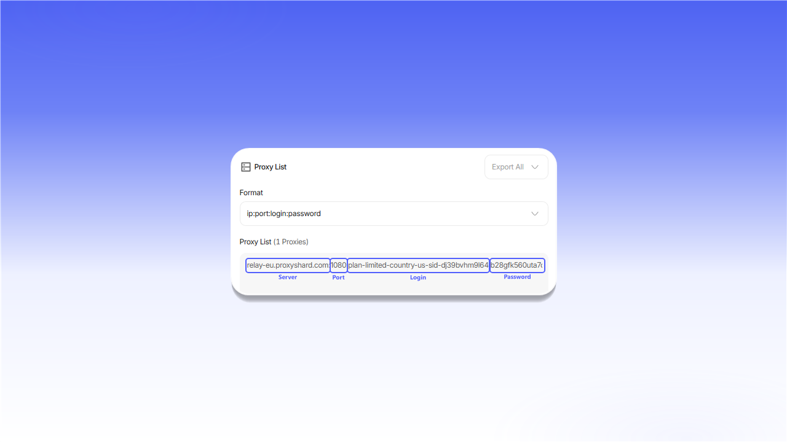

# Інструкція з налаштування

Перед налаштуванням програми відкрийте потрібне [замовлення](https://dashboard.proxyshard.com/products) і підготуйте дані підключення.


У прикладах нижче використовується `SOCKS5`. Якщо програма підтримує лише HTTP, виберіть `HTTP` у налаштуваннях замовлення та вкажіть відповідний порт.


## Резидентські проксі

1. У блоці `Proxy settings` виберіть країну та налаштуйте `Session`, `Relay` і `Protocol`.
2. Натисніть `Generate proxy`.
3. Скопіюйте готовий рядок із блоку `Proxy List`.

<figure>
  <picture>
    <source srcset="../.gitbook/assets/residential-proxy-setup_black.png" media="(prefers-color-scheme: dark)">
    
  </picture>
</figure>

## Датацентр- та ISP-проксі

Відкрийте замовлення і скопіюйте рядок підключення з блоку `Proxy List`.

<figure>
  <picture>
    <source srcset="../.gitbook/assets/static-proxy-setup_black.png" media="(prefers-color-scheme: dark)">
    
  </picture>
</figure>

## Формат рядка підключення

Стандартний формат: `server:port:login:password`.

<figure>
  <picture>
    <source srcset="../.gitbook/assets/proxy-format-breakdown_black.png" media="(prefers-color-scheme: dark)">
    
  </picture>
</figure>

| Поле | Опис |
|---|---|
| `Server / Host` | IP-адреса або домен проксі-сервера |
| `Port` | Порт підключення |
| `Login` | Ім'я користувача. Для резидентських проксі воно також може містити параметри таргетингу |
| `Password` | Пароль доступу |

Якщо програма не приймає повний рядок, введіть ці значення в окремі поля.

## Вибір протоколу

Для датацентр- та ISP-проксі перемкніть формат у блоці `Proxy List`.

<figure>
  <picture>
    <source srcset="../.gitbook/assets/proxy-protocol-toggle_black.png" media="(prefers-color-scheme: dark)">
    
  </picture>
</figure>

Для резидентських проксі виберіть протокол у полі `Protocol` перед генерацією рядка.

<figure>
  <picture>
    <source srcset="../.gitbook/assets/proxy-protocol-select_black.png" media="(prefers-color-scheme: dark)">
    
  </picture>
</figure>

Мобільні проксі приймають HTTP- і SOCKS5-підключення на виданому порту. Додатково перемикати формат у замовленні не потрібно.
