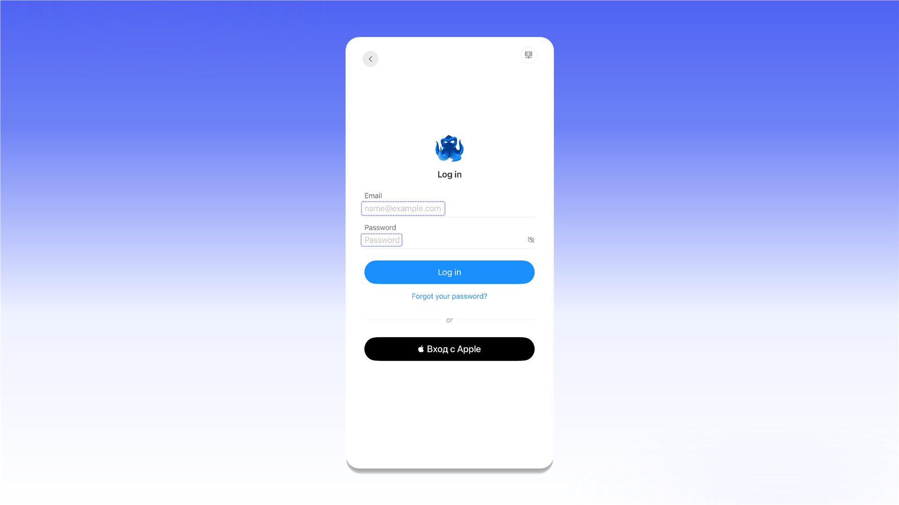
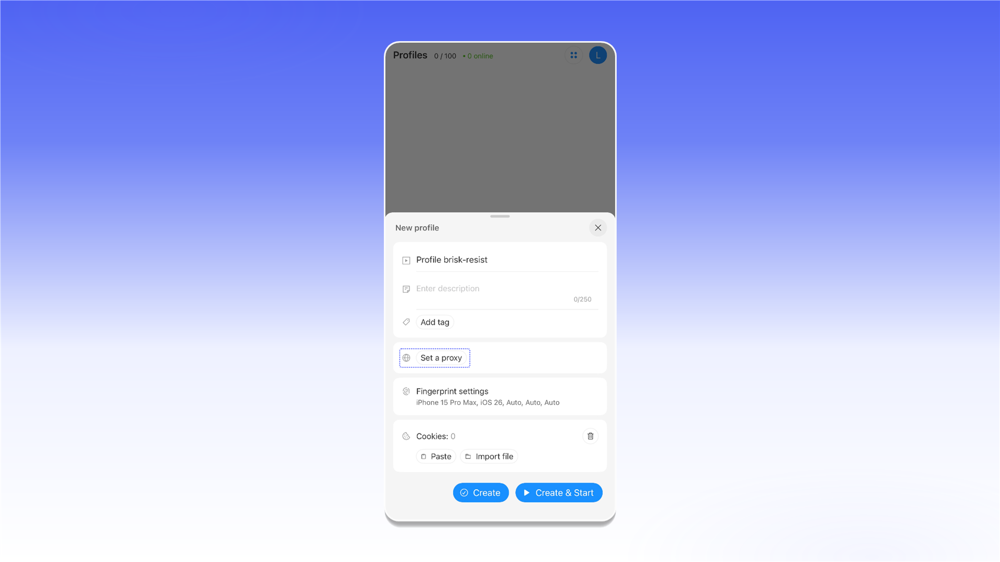
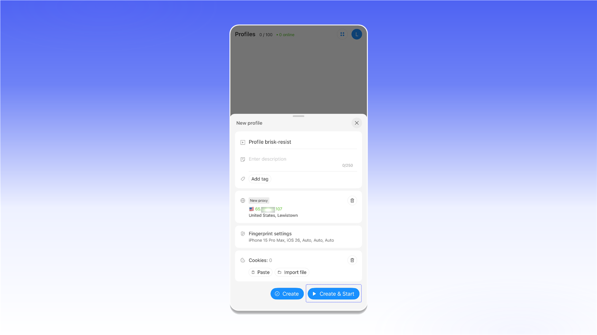

# Octo Browser для iOS та Android


Проксі працює лише всередині запущеного профілю Octo Browser. Інші застосунки на пристрої продовжують використовувати звичайне інтернет-з'єднання.


## Встановлення Octo Browser

Завантажте Octo Browser з App Store або Google Play.





## Реєстрація та вхід

Зареєструйтеся за допомогою електронної пошти або натисніть **Sign up with Apple**.

<figure>
  <picture>
    <source srcset="../../.gitbook/assets/octo-browser-ios-log-in_black.png" media="(prefers-color-scheme: dark)">
    
  </picture>
</figure>

Після реєстрації увійдіть до облікового запису тим самим способом.

## Створення профілю з проксі

На екрані **Profiles** натисніть **Create Profile**.

<figure>
  <picture>
    <source srcset="../../.gitbook/assets/octo-browser-ios-create-profile_black.png" media="(prefers-color-scheme: dark)">
    
  </picture>
</figure>

У налаштуваннях нового профілю натисніть **Set a proxy**.

<figure>
  <picture>
    <source srcset="../../.gitbook/assets/octo-browser-ios-set-proxy_black.png" media="(prefers-color-scheme: dark)">
    
  </picture>
</figure>

1. У полі **Type** виберіть HTTP, HTTPS або SOCKS5.
2. Скопіюйте повний рядок підключення з потрібного замовлення ShardX і вставте його в поле **Proxy**.
3. Натисніть **Check proxy**. Після успішної перевірки застосунок покаже IP-адресу, локацію та часовий пояс підключення.
4. Натисніть **Done**.

<figure>
  <picture>
    <source srcset="../../.gitbook/assets/octo-browser-ios-proxy-form_black.png" media="(prefers-color-scheme: dark)">
    
  </picture>
</figure>

## Запуск профілю

Натисніть **Create & Start**, щоб зберегти профіль і відразу запустити його.

<figure>
  <picture>
    <source srcset="../../.gitbook/assets/octo-browser-ios-profile-ready_black.png" media="(prefers-color-scheme: dark)">
    
  </picture>
</figure>

Готово. Трафік цього профілю Octo Browser спрямовуватиметься через доданий проксі.
