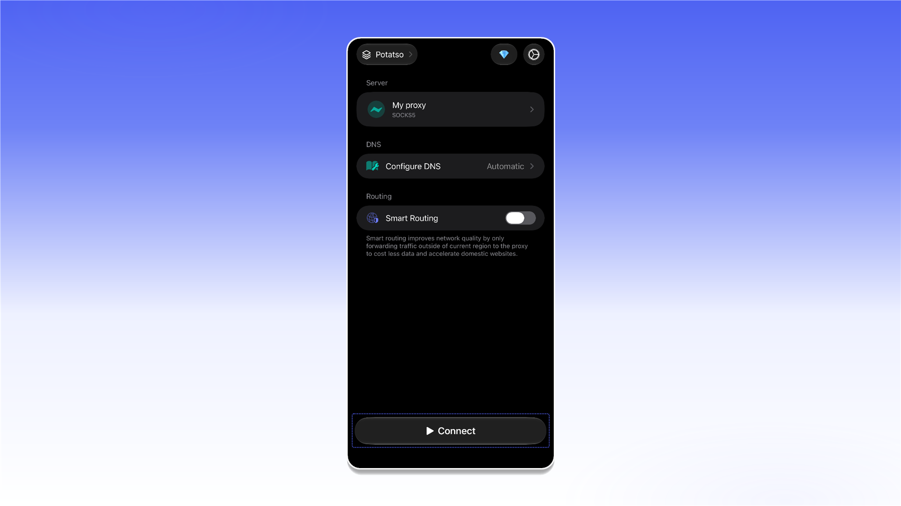

# Potatso

## Встановлення Potatso

Встановіть Potatso з App Store.



## Налаштування Potatso

Відкрийте застосунок і натисніть `Add Servers`.

<figure>
  <picture>
    <source srcset="../../.gitbook/assets/potatso-ios-add-servers_black.png" media="(prefers-color-scheme: dark)">
    
  </picture>
</figure>

Виберіть `Manual Input`.

<figure>
  <picture>
    <source srcset="../../.gitbook/assets/potatso-ios-manual-input_black.png" media="(prefers-color-scheme: dark)">
    
  </picture>
</figure>

## Налаштування профілю

Виберіть тип підключення та заповніть форму даними з `Proxy List` вашого замовлення:

1. Укажіть адресу сервера та порт.
2. Введіть логін і пароль.
3. Збережіть конфігурацію.

<figure>
  <picture>
    <source srcset="../../.gitbook/assets/potatso-ios-add-server-form_black.png" media="(prefers-color-scheme: dark)">
    
  </picture>
</figure>


Формат даних і приклад замовлення описані в розділі [Початок роботи](../getting-started.md).


Виберіть створену конфігурацію та ввімкніть підключення.

<figure>
  <picture>
    <source srcset="../../.gitbook/assets/potatso-ios-connect_black.png" media="(prefers-color-scheme: dark)">
    
  </picture>
</figure>

Проксі підключено та готово до роботи в Potatso.
