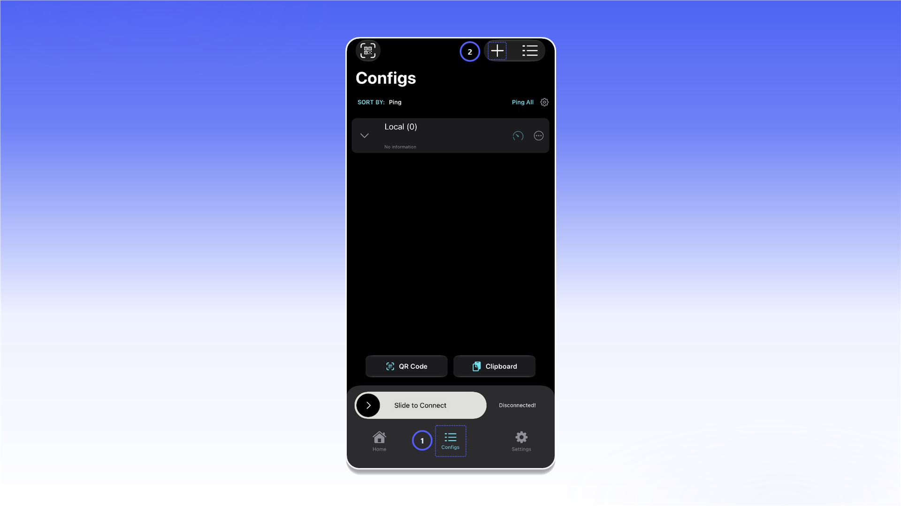
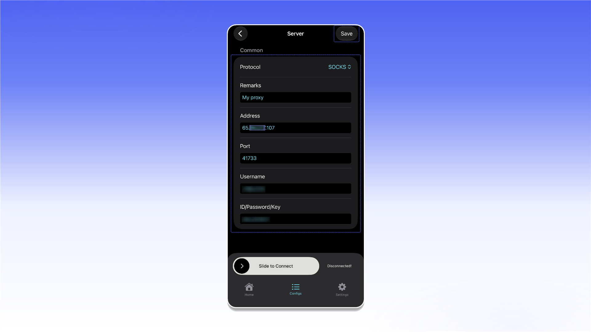
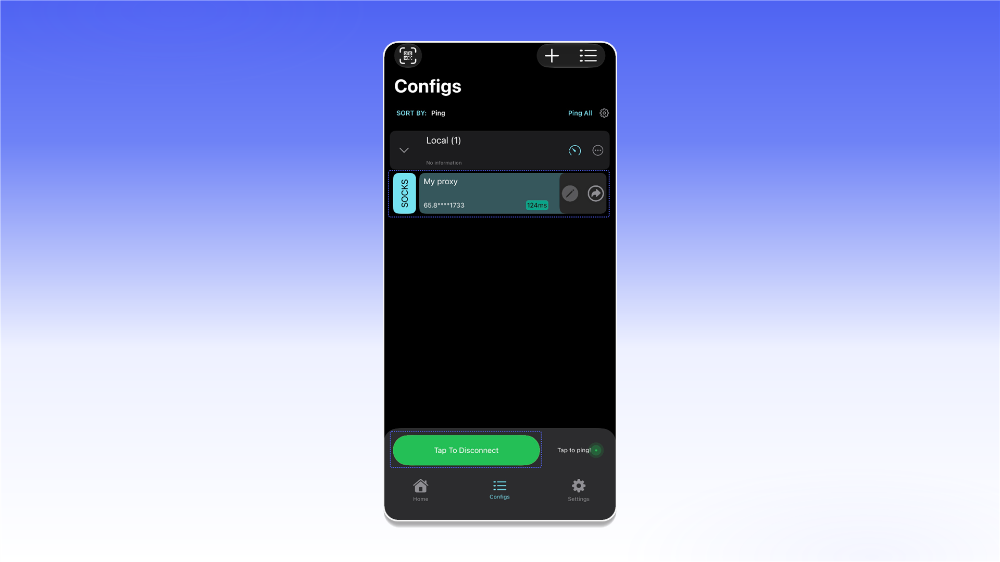

# V2Box


V2Box підтримує UDP-трафік.


## Встановлення V2Box

Встановіть V2Box із магазину застосунків для вашого пристрою.

#### <mark style="color:green;">Android</mark>



#### <mark style="color:blue;">**iOS**</mark>



## Налаштування V2Box

1. Відкрийте `Configs`.
2. Натисніть `+`, щоб створити конфігурацію.

<figure>
  <picture>
    <source srcset="../../.gitbook/assets/v2box-ios-configs-add_black.png" media="(prefers-color-scheme: dark)">
    
  </picture>
</figure>

<figure>
  <picture>
    <source srcset="../../.gitbook/assets/v2box-ios-add-manual-config_black.png" media="(prefers-color-scheme: dark)">
    
  </picture>
</figure>

У полі `Protocol` виберіть `SOCKS`.

<figure>
  <picture>
    <source srcset="../../.gitbook/assets/v2box-ios-protocol-socks_black.png" media="(prefers-color-scheme: dark)">
    
  </picture>
</figure>

Уведіть назву конфігурації в полі `Remarks`. Заповніть поля `Address`, `Port`, `Username` і `ID/Password/Key` даними з `Proxy List` вашого замовлення, потім натисніть `Save`.

<figure>
  <picture>
    <source srcset="../../.gitbook/assets/v2box-ios-server-form_black.png" media="(prefers-color-scheme: dark)">
    
  </picture>
</figure>


Формат даних і приклад замовлення описані в розділі [Початок роботи](../getting-started.md).


Поверніться до `Configs`, виберіть створену конфігурацію та використайте `Slide to Connect` для підключення.

<figure>
  <picture>
    <source srcset="../../.gitbook/assets/v2box-ios-connected_black.png" media="(prefers-color-scheme: dark)">
    
  </picture>
</figure>

Перевірте підключення через [Proxy Tester](../../our-products/proxy-tester.md).
