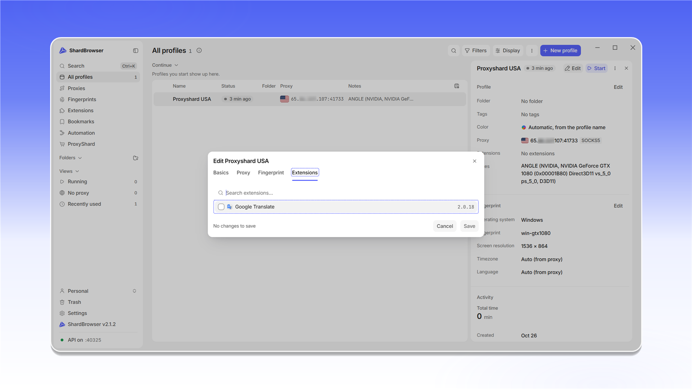

# Extensions

У розділі <mark style="color:purple;">**Extensions**</mark> зберігаються розширення, які можна підключати до профілів. Розширення додається один раз, а потім вмикається в потрібних профілях.

Натисніть <mark style="color:purple;">**+ Add an extension**</mark>. Додати розширення можна посиланням на Chrome Web Store, файлом <mark style="color:purple;">`.crx`</mark> / <mark style="color:purple;">`.zip`</mark> або папкою.

<figure>
  <picture>
    <source srcset="../../.gitbook/assets/shardbrowser-extensions-empty_black.png" media="(prefers-color-scheme: dark)">
    
  </picture>
  <figcaption>Розділ Extensions</figcaption>
</figure>

У вікні <mark style="color:purple;">**Add from a link**</mark> вставте посилання на сторінку розширення у Web Store, його id або пряме посилання на `.crx` / `.zip`. Із посилання на Web Store ShardBrowser сам візьме id і завантажить розширення. Натисніть <mark style="color:purple;">**Download**</mark>.

<figure>
  <picture>
    <source srcset="../../.gitbook/assets/shardbrowser-extension-add-link_black.png" media="(prefers-color-scheme: dark)">
    
  </picture>
  <figcaption>Вставте посилання і натисніть «Download»</figcaption>
</figure>

Розширення з'явиться у списку з версією та розміром.

<figure>
  <picture>
    <source srcset="../../.gitbook/assets/shardbrowser-extensions-list_black.png" media="(prefers-color-scheme: dark)">
    
  </picture>
  <figcaption>Розширення додано</figcaption>
</figure>

Щоб увімкнути розширення в профілі, відкрийте редагування профілю (<mark style="color:purple;">**Edit**</mark>), перейдіть на вкладку <mark style="color:purple;">**Extensions**</mark>, позначте потрібні розширення і натисніть <mark style="color:purple;">**Save**</mark>. Розширення також можна вибрати одразу під час створення профілю, на вкладці <mark style="color:purple;">**Extensions**</mark> вікна <mark style="color:purple;">**New profile**</mark>.

<figure>
  <picture>
    <source srcset="../../.gitbook/assets/shardbrowser-profile-edit-extensions_black.png" media="(prefers-color-scheme: dark)">
    
  </picture>
  <figcaption>Позначте розширення в профілі і натисніть «Save»</figcaption>
</figure>
