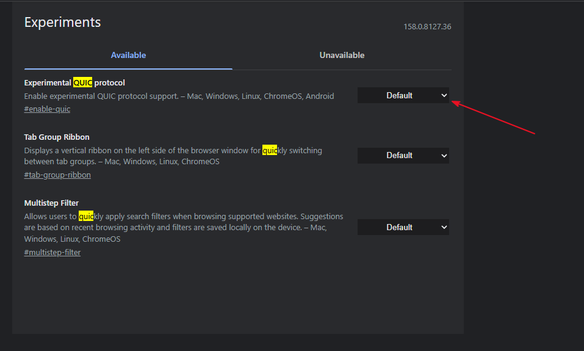
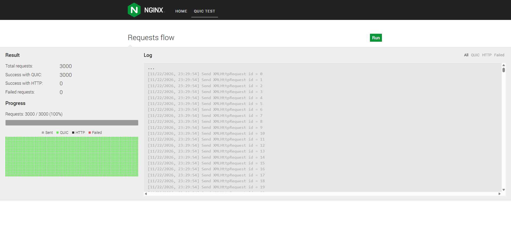
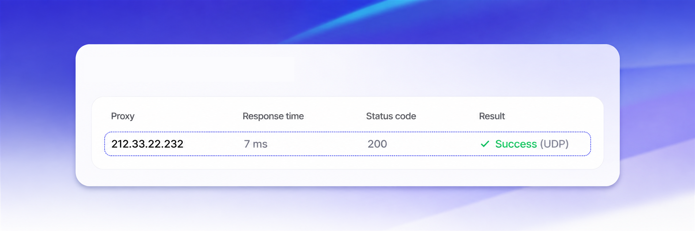
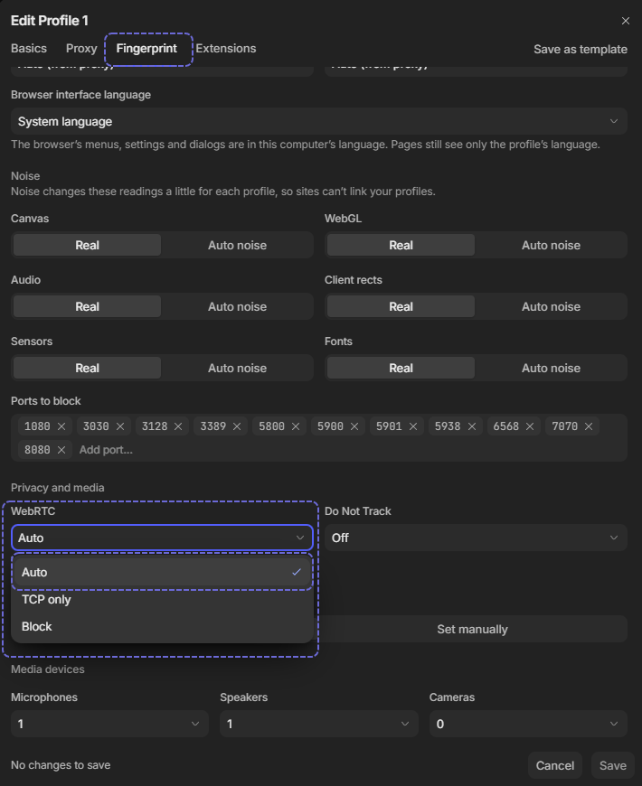

# Чому QUIC не працює, якщо проксі підтримує UDP?

Якщо QUIC працює у звичайному профілі Google Chrome, але не працює у профілі ShardBrowser, перевірте прапорці браузера й політики Windows. Політика може забороняти QUIC, навіть коли його ввімкнено в `chrome://flags`.


Перед запуском профілю ShardBrowser перевіряє, чи проксі підтримує `SOCKS5 UDP_ASSOCIATE`. Якщо UDP доступний, QUIC залишається ввімкненим автоматично; зазвичай змінювати прапорець вручну не потрібно. Ця інструкція потрібна, якщо перевірка UDP проходить, але тест QUIC усе одно не проходить.


## 1. Перевірте QUIC у звичайному Chrome

Відкрийте Google Chrome зі звичайним профілем і перейдіть за адресою:

```text
chrome://flags/#enable-quic
```

Для параметра **Experimental QUIC protocol** має бути вибрано **Default** або **Enabled**. Якщо вибрано **Disabled**, перемкніть параметр на **Enabled** і перезапустіть браузер.

<figure><figcaption>Параметр Experimental QUIC protocol має бути ввімкнений</figcaption></figure>

Потім відкрийте [тест QUIC від NGINX](https://quic.nginx.org/quic.html), натисніть **Run** і дочекайтеся результату. Запити в рядку **Success with QUIC** означають, що QUIC працює.

<figure><figcaption>Успішні запити в рядку Success with QUIC</figcaption></figure>

## 2. Повторіть перевірку в ShardBrowser

У потрібному профілі ShardBrowser відкрийте ту саму адресу:

```text
chrome://flags/#enable-quic
```

Виберіть **Default** або **Enabled**, за потреби перезапустіть профіль і повторіть тест NGINX.

Для коректного порівняння використовуйте однакове підключення. Наприклад, спочатку запустіть обидва браузери без проксі в налаштуваннях браузера.


Якщо в Chrome тест проходить, а в ShardBrowser ні, однією з можливих причин є заборона QUIC у політиках Windows.


## 3. Перевірте політики через PowerShell

Відкрийте PowerShell і виконайте:

```powershell
reg query "HKEY_LOCAL_MACHINE\SOFTWARE\Policies\Chromium" /v QuicAllowed
reg query "HKEY_CURRENT_USER\SOFTWARE\Policies\Chromium" /v QuicAllowed
reg query "HKEY_LOCAL_MACHINE\SOFTWARE\Policies\Google\Chrome" /v QuicAllowed
reg query "HKEY_CURRENT_USER\SOFTWARE\Policies\Google\Chrome" /v QuicAllowed
```

Як читати результат:

* **`QuicAllowed REG_DWORD 0x0`** - QUIC заборонено політикою.
* **`QuicAllowed REG_DWORD 0x1`** - QUIC дозволено політикою.
* **«Не вдається знайти зазначений розділ або параметр»** - у цій гілці налаштування відсутнє; саме по собі це не означає заборону.

Звичайний Chrome і ShardBrowser можуть використовувати різні гілки реєстру для політик: `Google\Chrome` і `Chromium`. Тому обмеження в гілці `Chromium` може впливати на ShardBrowser, не зачіпаючи звичайний Chrome.

## 4. Зніміть виявлене обмеження

Якщо саме в гілці `HKEY_LOCAL_MACHINE\SOFTWARE\Policies\Chromium` знайдено `QuicAllowed = 0x0`, відкрийте **PowerShell від імені адміністратора** й виконайте:

```powershell
Set-ItemProperty -Path 'HKLM:\SOFTWARE\Policies\Chromium' -Name 'QuicAllowed' -Value 1
```

Якщо обмеження виявлено в іншій гілці, укажіть у команді відповідний шлях.


На робочому або керованому організацією комп'ютері не змінюйте політики самостійно: зверніться до системного адміністратора. Централізована політика може повернути попереднє значення.


Повністю закрийте профілі ShardBrowser, запустіть їх знову й повторіть тест NGINX. Перезавантажувати Windows не потрібно.


Якщо команда перевірки вже показує `QuicAllowed REG_DWORD 0x1`, QUIC у цій гілці дозволено й повторно змінювати параметр не потрібно.


## 5. Якщо без проксі QUIC працює, а з проксі - ні

1. Переконайтеся, що у профілі використовується проксі **SOCKS5**. Для передавання QUIC через проксі потрібна підтримка SOCKS5 UDP-relay.
2. Перевірте підтримку UDP і маршрут WebRTC:
   * в [IP Checker](https://shardx.com/ip-checker) зверніть увагу на поле **WebRTC IP** - за правильного налаштування в ньому має відображатися IP-адреса проксі, а не ваша справжня публічна IP-адреса;
   * у [Proxy Tester](https://shardx.com/proxy-tester) зелена позначка **Success (UDP)** підтверджує підтримку UDP-relay.

<figure><figcaption>Proxy Tester підтверджує підтримку UDP</figcaption></figure>

3. Відкрийте налаштування профілю ShardBrowser і на вкладці **Fingerprint** встановіть для параметра **WebRTC** режим **Auto**.

<figure><figcaption>Для параметра WebRTC вибрано режим Auto</figcaption></figure>

Після зміни налаштувань повністю закрийте профіль і запустіть його знову, щоб ShardBrowser повторно перевірив проксі.

## 6. Якщо QUIC усе ще не працює

Відкрийте в проблемному профілі:

```text
chrome://policy
```

Натисніть **Reload policies** або **Оновити політики** й знайдіть `QuicAllowed`. Якщо політики, що забороняє QUIC, немає, перевірте параметри запуску профілю, підтримку UDP у проксі та мережевий журнал браузера.

Відсутність QUIC лише в одному браузері сама по собі ще не доводить, що проблема пов'язана з проксі або VPN.


QUIC також може не працювати через вбудований брандмауер Windows, правила фаєрвола маршрутизатора, особливості роботи VPN або обмеження з боку інтернет-провайдера. Деякі VPN не передають QUIC або блокують UDP-трафік. Таке також трапляється у країнах із жорстким регулюванням і фільтрацією інтернет-трафіку: оператор або мережевий фільтр може блокувати UDP-трафік на порту `443` чи сам протокол QUIC. У такому разі проблема виникає на мережевому рівні й не пов'язана з налаштуваннями ShardBrowser.

