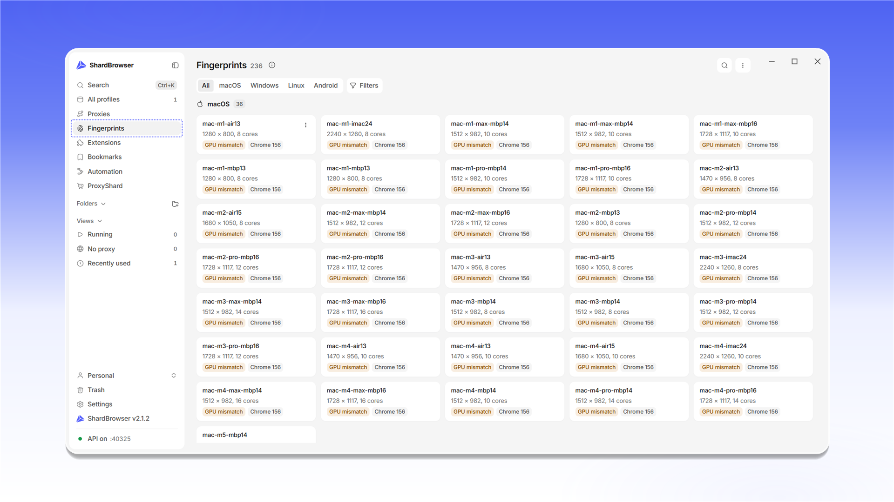
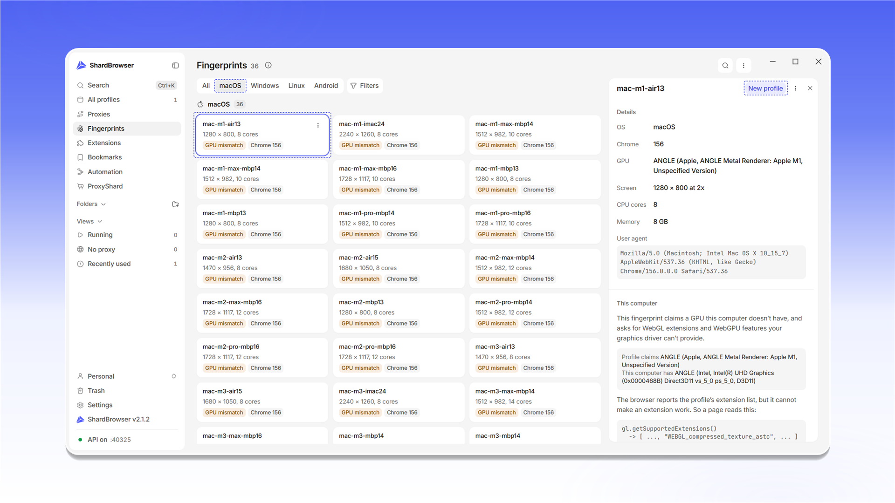

# Fingerprints

Розділ <mark style="color:purple;">**Fingerprints**</mark> - це бібліотека відбитків реальних пристроїв, з яких ShardBrowser збирає профілі. Кожен відбиток описує конкретну машину: операційну систему, версію Chrome, відеокарту, екран, кількість ядер і обсяг пам'яті.

Угорі розташовані фільтри за системою: <mark style="color:purple;">**All**</mark>, <mark style="color:purple;">**macOS**</mark>, <mark style="color:purple;">**Windows**</mark>, <mark style="color:purple;">**Linux**</mark> та <mark style="color:purple;">**Android**</mark>, а також додаткові <mark style="color:purple;">**Filters**</mark> і пошук. На картці відбитка вказано роздільну здатність екрана, кількість ядер і версію Chrome.

<figure>
  <picture>
    <source srcset="../../.gitbook/assets/shardbrowser-fingerprints-list_black.png" media="(prefers-color-scheme: dark)">
    
  </picture>
  <figcaption>Розділ Fingerprints</figcaption>
</figure>

Мітка <mark style="color:purple;">**GPU mismatch**</mark> означає, що відбиток заявляє відеокарту, якої немає на вашому комп'ютері. Такий профіль працює, але частину можливостей WebGL і WebGPU, заявлених відбитком, браузер виконати не зможе. Докладне пояснення показано в картці відбитка, у блоці <mark style="color:purple;">**This computer**</mark>.

Натисніть на відбиток, щоб відкрити його картку. У блоці <mark style="color:purple;">**Details**</mark> вказано ОС, версію Chrome, відеокарту, екран, ядра, пам'ять і <mark style="color:purple;">User agent</mark>. Кнопка <mark style="color:purple;">**New profile**</mark> створює профіль одразу на основі цього відбитка.

<figure>
  <picture>
    <source srcset="../../.gitbook/assets/shardbrowser-fingerprint-details_black.png" media="(prefers-color-scheme: dark)">
    
  </picture>
  <figcaption>Картка відбитка, кнопка «New profile»</figcaption>
</figure>
