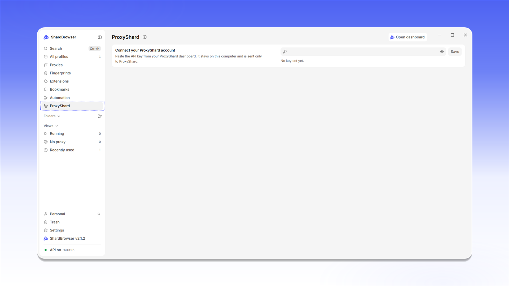
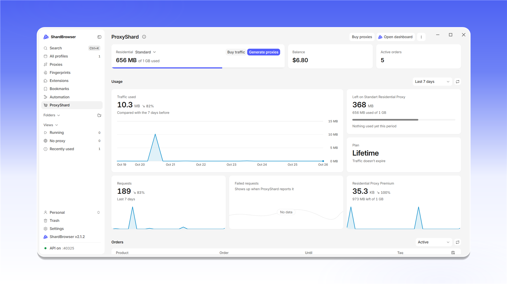

# ShardX Dashboard

Розділ <mark style="color:purple;">**ShardX**</mark> підключає ваш акаунт [ShardX](https://proxyshard.com) до застосунку: баланс, трафік, замовлення та купівля проксі доступні просто в ShardBrowser.

Щоб підключити акаунт, скопіюйте API-ключ у [налаштуваннях особистого кабінету ShardX](https://dashboard.shardx.com/en/profile?tab=api-key) і вставте його в поле блоку <mark style="color:purple;">**Connect your ShardX account**</mark>.

<figure>
  <picture>
    <source srcset="../../.gitbook/assets/shardbrowser-proxyshard-connect_black.png" media="(prefers-color-scheme: dark)">
    
  </picture>
  <figcaption>Розділ ShardX</figcaption>
</figure>

Натисніть <mark style="color:purple;">**Save**</mark>.


API-ключ зберігається на вашому комп'ютері та надсилається лише до ShardX. Не передавайте його стороннім.


<figure>
  <picture>
    <source srcset="../../.gitbook/assets/shardbrowser-proxyshard-api-key_black.png" media="(prefers-color-scheme: dark)">
    
  </picture>
  <figcaption>Вставте API-ключ і натисніть «Save»</figcaption>
</figure>

Після підключення відкриється панель акаунта:

- **Residential** - залишок трафіку резидентних проксі, кнопки <mark style="color:purple;">**Buy traffic**</mark> та <mark style="color:purple;">**Generate proxies**</mark>
- **Balance** - баланс акаунта
- **Active orders** - кількість активних замовлень
- **Usage** - графік витраченого трафіку та кількість запитів за вибраний період, а також невдалі запити (<mark style="color:purple;">**Failed requests**</mark>)
- **Orders** - список замовлень із продуктом, номером замовлення, терміном дії та тегом

Кнопка <mark style="color:purple;">**Buy proxies**</mark> відкриває купівлю проксі, <mark style="color:purple;">**Open dashboard**</mark> - особистий кабінет на сайті.

<figure>
  <picture>
    <source srcset="../../.gitbook/assets/shardbrowser-proxyshard-dashboard_black.png" media="(prefers-color-scheme: dark)">
    
  </picture>
  <figcaption>Панель акаунта ShardX</figcaption>
</figure>
