# Team server


Тім-сервер дає змогу кільком людям працювати зі спільними профілями ShardBrowser. Сервер ви запускаєте самі, наприклад на VPS: профілі команди зберігаються на ньому, а лаунчери учасників підключаються до сервера за інвайтом. Адміністратор сам вирішує, які папки й дії доступні кожному учаснику.


## Що знадобиться

* ShardBrowser версії 2.1.2 або новішої на комп'ютерах усіх учасників.
* Сервер, до якого учасники можуть підключитися через мережу, наприклад VPS на Ubuntu з доступом по SSH під `root` або користувачем із `sudo`.
* Відкритий вхідний порт <mark style="color:purple;">`8787`</mark> (TCP) на сервері.

---

## Створення команди в ShardBrowser

У лівому нижньому куті натисніть на перемикач робочого простору <mark style="color:purple;">**Personal**</mark> і виберіть <mark style="color:purple;">**Create a team...**</mark>.

<figure>
  <picture>
    <source srcset="../../.gitbook/assets/shardbrowser-team-workspace-menu_black.png" media="(prefers-color-scheme: dark)">
    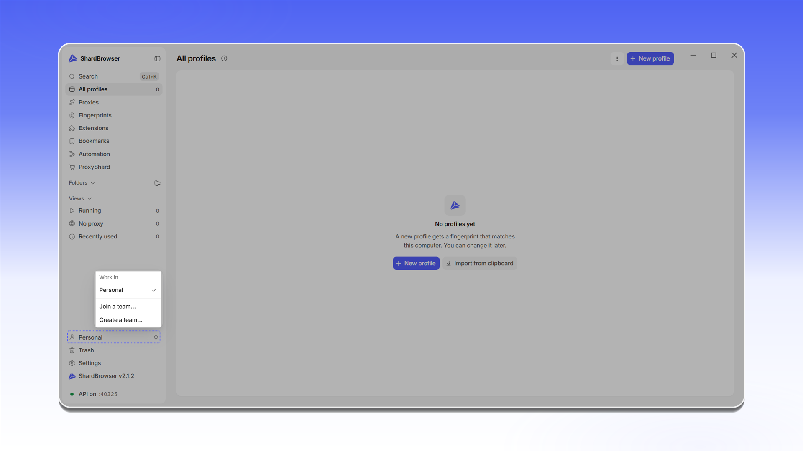
  </picture>
  <figcaption>Меню робочого простору - «Create a team...»</figcaption>
</figure>

Відкриється вікно <mark style="color:purple;">**Create a team**</mark>. У полі <mark style="color:purple;">**Team name**</mark> вкажіть назву команди. Сервер читає її лише під час першого запуску, пізніше команду можна перейменувати на її сторінці.

<figure>
  <picture>
    <source srcset="../../.gitbook/assets/shardbrowser-team-create-dialog_black.png" media="(prefers-color-scheme: dark)">
    
  </picture>
  <figcaption>Вікно Create a team - вкажіть назву команди</figcaption>
</figure>

Не закривайте це вікно: команда для запуску сервера й поля для підключення знадобляться далі.

---

## Встановлення Docker і тім-сервера на VPS

Підключіться до сервера по SSH і встановіть Docker офіційним скриптом:

```bash
curl -fsSL https://get.docker.com -o get-docker.sh
sudo sh get-docker.sh
```

Скрипт сам додасть репозиторій Docker, встановить пакети й запустить службу. Наприкінці він виведе версії клієнта й сервера Docker Engine.

<figure>
  <picture>
    <source srcset="../../.gitbook/assets/shardbrowser-team-vps-docker-install_black.png" media="(prefers-color-scheme: dark)">
    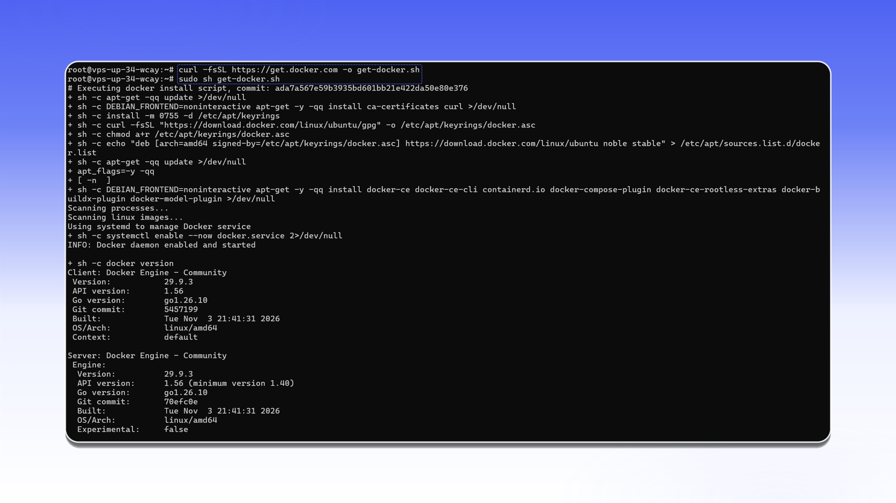
  </picture>
  <figcaption>Встановлення Docker скриптом get-docker.sh</figcaption>
</figure>

Якщо наприкінці з'явилося повідомлення про rootless-режим і доступ до Docker API, це звичайна довідка від інсталятора. Для тім-сервера нічого додатково налаштовувати не потрібно.

<figure>
  <picture>
    <source srcset="../../.gitbook/assets/shardbrowser-team-vps-docker-install-done_black.png" media="(prefers-color-scheme: dark)">
    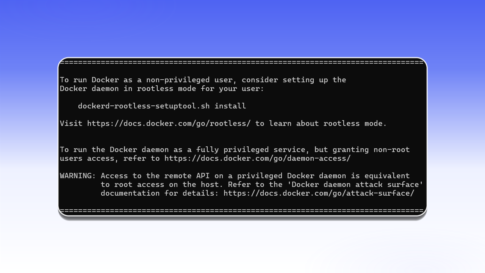
  </picture>
  <figcaption>Довідка інсталятора Docker наприкінці встановлення</figcaption>
</figure>

Поверніться до ShardBrowser. На вкладці <mark style="color:purple;">**Docker**</mark> вікна <mark style="color:purple;">**Create a team**</mark> уже готова команда запуску сервера з назвою вашої команди. Скопіюйте її кнопкою праворуч від поля.

<figure>
  <picture>
    <source srcset="../../.gitbook/assets/shardbrowser-team-create-docker-command_black.png" media="(prefers-color-scheme: dark)">
    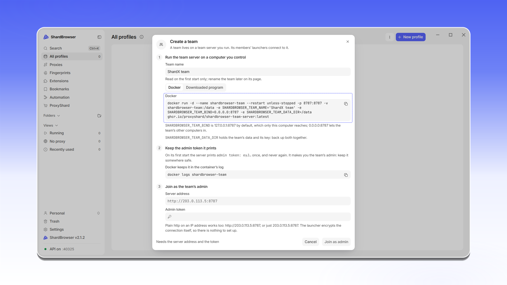
  </picture>
  <figcaption>Скопіюйте команду запуску на вкладці Docker</figcaption>
</figure>


`SHARDBROWSER_TEAM_BIND` за замовчуванням дорівнює `127.0.0.1:8787`, і тоді до сервера можна підключитися лише з цієї ж машини. Щоб підключалися інші учасники, залиште в команді `0.0.0.0:8787`.

`SHARDBROWSER_TEAM_DATA_DIR` - папка з даними команди та її ключем. Робіть резервну копію всієї папки повністю.


На сервері увімкніть автозапуск Docker, перевірте встановлення й виконайте скопійовану команду:

```bash
sudo systemctl enable docker
sudo systemctl start docker
sudo usermod -aG docker $USER
docker --version
docker compose version
```

```bash
docker run -d --name shardbrowser-team --restart unless-stopped -p 8787:8787 -v shardbrowser-team:/data -e SHARDBROWSER_TEAM_NAME='ShardX team' -e SHARDBROWSER_TEAM_BIND=0.0.0.0:8787 -e SHARDBROWSER_TEAM_DATA_DIR=/data ghcr.io/proxyshard/shardbrowser-team-server:latest
```

Замість `ShardX team` у команді буде назва, яку ви вказали. Docker завантажить образ `shardbrowser-team-server` і запустить контейнер `shardbrowser-team`. Завдяки `--restart unless-stopped` сервер сам підніметься після перезавантаження VPS.

<figure>
  <picture>
    <source srcset="../../.gitbook/assets/shardbrowser-team-vps-server-run_black.png" media="(prefers-color-scheme: dark)">
    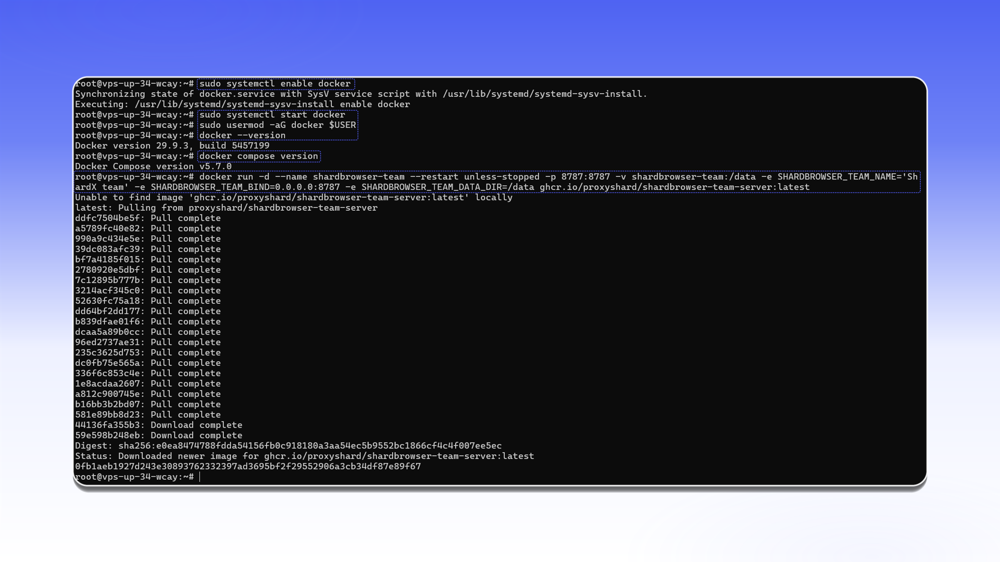
  </picture>
  <figcaption>Запуск контейнера тім-сервера</figcaption>
</figure>

Під час першого запуску сервер один раз виводить у лог токен адміністратора. Перегляньте його командою:

```bash
docker logs shardbrowser-team
```

Скопіюйте значення <mark style="color:purple;">`admin token`</mark>. У лозі також є <mark style="color:purple;">`invite`</mark> (посилання з тим самим токеном, замість `0.0.0.0` підставте адресу сервера) і <mark style="color:purple;">`public key`</mark>, за яким лаунчери перевіряють сервер.

<figure>
  <picture>
    <source srcset="../../.gitbook/assets/shardbrowser-team-vps-admin-token_black.png" media="(prefers-color-scheme: dark)">
    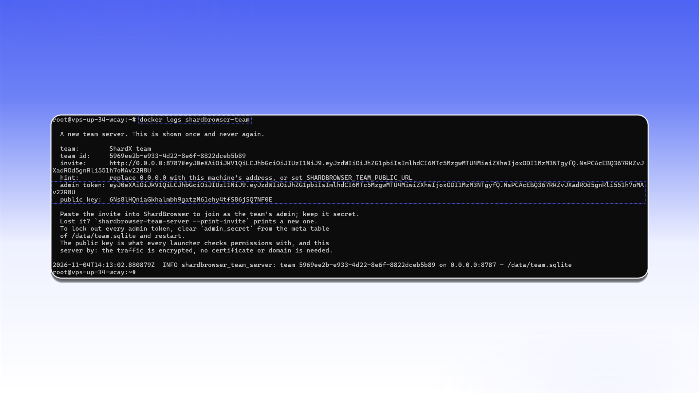
  </picture>
  <figcaption>Токен адміністратора в лозі контейнера</figcaption>
</figure>


Токен адміністратора показується лише під час першого запуску й дає повний доступ до команди. Збережіть його в надійному місці й нікому не передавайте. Якщо токен втрачено, команда `shardbrowser-team-server --print-invite` виведе новий.


---

## Підключення до команди як адміністратор

У вікні <mark style="color:purple;">**Create a team**</mark>, у блоці <mark style="color:purple;">**Join as the team's admin**</mark>, заповніть поля:

* <mark style="color:purple;">**Server address**</mark> - IP-адреса сервера й порт, наприклад `203.0.113.5:8787` або `http://203.0.113.5:8787`. Домен і сертифікат не потрібні: лаунчер сам шифрує з'єднання.
* <mark style="color:purple;">**Admin token**</mark> - токен із логу контейнера.

Натисніть <mark style="color:purple;">**Join as admin**</mark>.

<figure>
  <picture>
    <source srcset="../../.gitbook/assets/shardbrowser-team-join-as-admin_black.png" media="(prefers-color-scheme: dark)">
    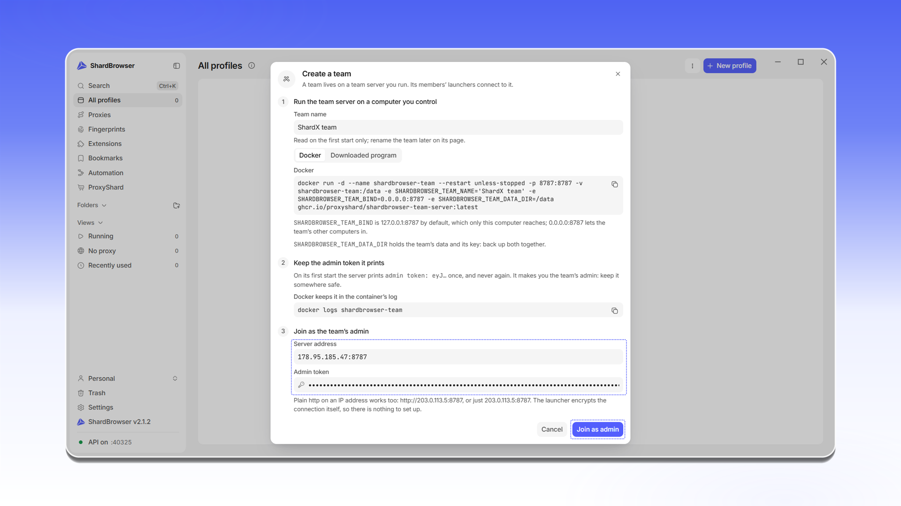
  </picture>
  <figcaption>Вкажіть адресу сервера й токен адміністратора</figcaption>
</figure>

Відкриється сторінка команди. У перемикачі ліворуч унизу тепер вибрана ваша команда. Профілі, створені в цьому режимі, зберігаються на тім-сервері. Блок <mark style="color:purple;">**Getting the team going**</mark> підказує порядок дій: створити папки, створити профілі, додати учасників і видати їм права.

<figure>
  <picture>
    <source srcset="../../.gitbook/assets/shardbrowser-team-page-empty_black.png" media="(prefers-color-scheme: dark)">
    
  </picture>
  <figcaption>Сторінка нової команди</figcaption>
</figure>

---

## Додавання учасника

Натисніть <mark style="color:purple;">**+ Add member**</mark>.

<figure>
  <picture>
    <source srcset="../../.gitbook/assets/shardbrowser-team-add-member-button_black.png" media="(prefers-color-scheme: dark)">
    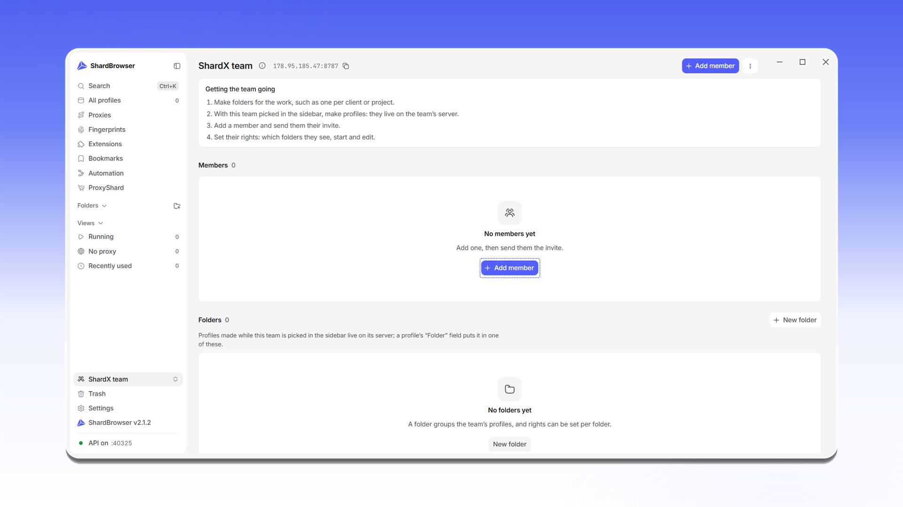
  </picture>
  <figcaption>Кнопка Add member</figcaption>
</figure>

Вкажіть ім'я учасника й натисніть <mark style="color:purple;">**Add member**</mark>.

<figure>
  <picture>
    <source srcset="../../.gitbook/assets/shardbrowser-team-add-member-dialog_black.png" media="(prefers-color-scheme: dark)">
    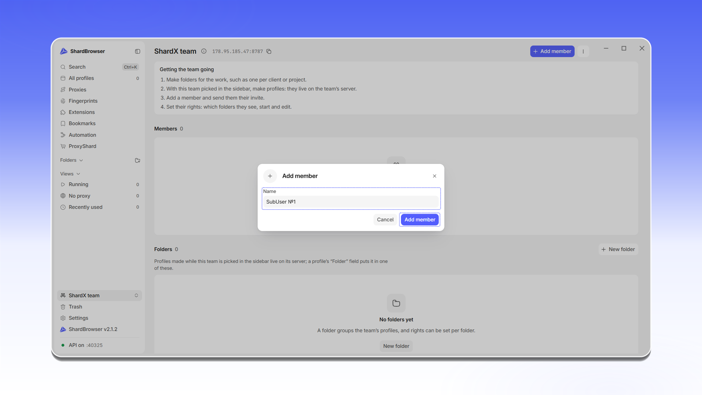
  </picture>
  <figcaption>Ім'я нового учасника</figcaption>
</figure>

З'явиться інвайт для учасника. Скопіюйте його й надішліть учаснику: він вставить його у вікні <mark style="color:purple;">**Join a team**</mark>. Інвайт показується лише один раз, новий можна створити через <mark style="color:purple;">**New invite...**</mark> у меню учасника.

Поки в учасника немає прав, команда для нього порожня. Натисніть <mark style="color:purple;">**Set rights...**</mark>, щоб одразу видати доступ.

<figure>
  <picture>
    <source srcset="../../.gitbook/assets/shardbrowser-team-member-invite_black.png" media="(prefers-color-scheme: dark)">
    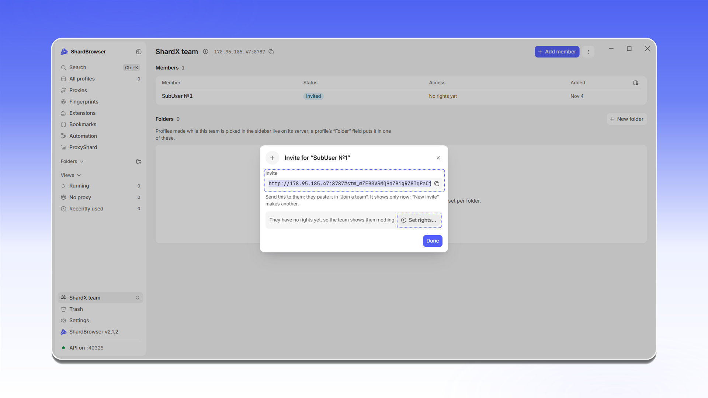
  </picture>
  <figcaption>Інвайт для учасника й кнопка Set rights</figcaption>
</figure>

---

## Права учасника

У вікні <mark style="color:purple;">**Rights**</mark> права задаються в таблиці. Натисніть на клітинку (або клавішу `Space`), щоб перемкнути її: не задано, дозволено (галочка) або заборонено (хрестик). Якщо правила перетинаються, діє найвужче.

| Право        | Що дозволяє                       |
| ------------ | --------------------------------- |
| **See**      | Бачити профілі                    |
| **Start**    | Запускати профілі                 |
| **Edit**     | Змінювати профілі                 |
| **Create**   | Створювати профілі                |
| **Delete**   | Видаляти профілі                  |
| **Cookies**  | Працювати з cookies профілів      |
| **Take out** | Виносити профілі з команди        |

Для швидкого налаштування рядка <mark style="color:purple;">**Whole team**</mark> є готові набори: <mark style="color:purple;">**None**</mark>, <mark style="color:purple;">**See only**</mark>, <mark style="color:purple;">**Start**</mark>, <mark style="color:purple;">**Edit**</mark> і <mark style="color:purple;">**All but take out**</mark>. Права також можна задати окремо для кожної папки команди. Натисніть <mark style="color:purple;">**Save rights**</mark>.

<figure>
  <picture>
    <source srcset="../../.gitbook/assets/shardbrowser-team-member-rights_black.png" media="(prefers-color-scheme: dark)">
    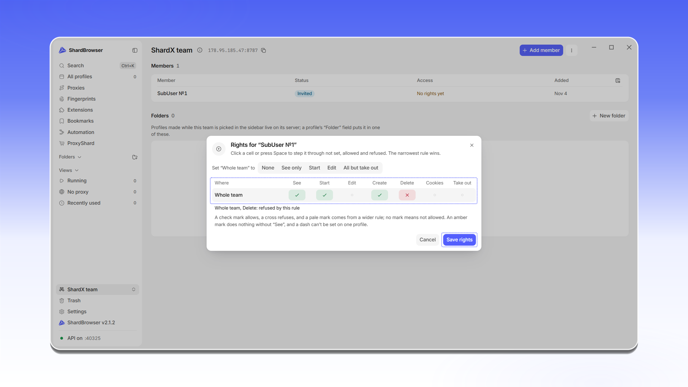
  </picture>
  <figcaption>Права учасника на всю команду</figcaption>
</figure>


Право без <mark style="color:purple;">**See**</mark> не працює: учасник не зможе запустити або змінити профіль, якого не бачить.


Видані права відображаються в колонці <mark style="color:purple;">**Access**</mark>. У меню учасника (<mark style="color:purple;">**⋮**</mark>) можна змінити права (<mark style="color:purple;">**Rights...**</mark>), тимчасово вимкнути учасника (<mark style="color:purple;">**Switch off**</mark>), створити новий інвайт (<mark style="color:purple;">**New invite...**</mark>) або видалити учасника з команди (<mark style="color:purple;">**Remove...**</mark>).

<figure>
  <picture>
    <source srcset="../../.gitbook/assets/shardbrowser-team-member-menu_black.png" media="(prefers-color-scheme: dark)">
    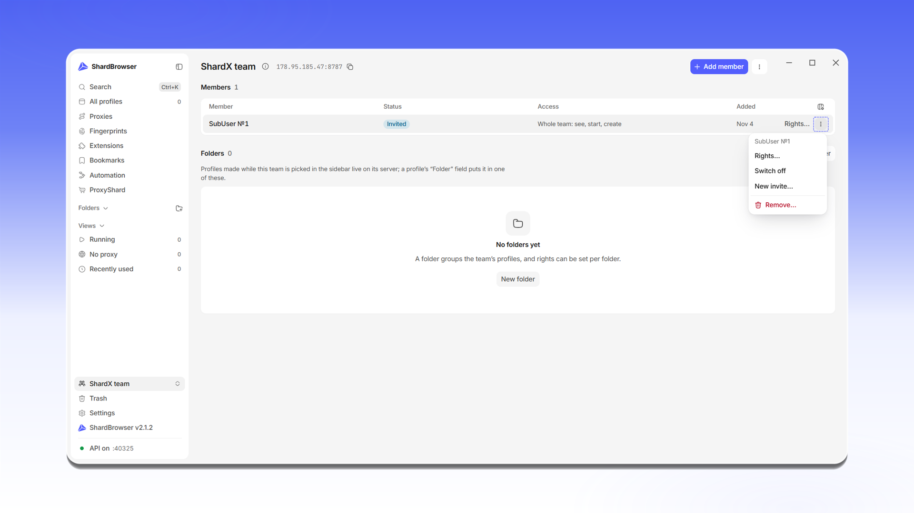
  </picture>
  <figcaption>Меню учасника</figcaption>
</figure>

---

## Папки й профілі команди

Папки команди створюються кнопкою <mark style="color:purple;">**+ New folder**</mark> на сторінці команди й з'являються в бічному меню, як звичайні папки. Новий профіль потрапляє в папку, вказану в його полі <mark style="color:purple;">**Folder**</mark>.

Перемикач робочого простору ліворуч унизу показує, де ви зараз працюєте: у <mark style="color:purple;">**Personal**</mark> (локальні профілі) або в команді, поруч із якою вказано адресу її сервера. З цього меню адміністратор відкриває сторінку команди (<mark style="color:purple;">**Manage team**</mark>), а також може підключитися до іншої команди, створити нову або вийти з поточної (<mark style="color:purple;">**Leave this team...**</mark>).

<figure>
  <picture>
    <source srcset="../../.gitbook/assets/shardbrowser-team-manage-team-menu_black.png" media="(prefers-color-scheme: dark)">
    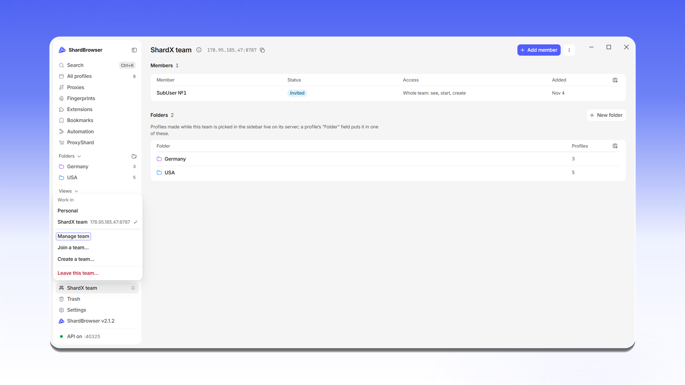
  </picture>
  <figcaption>Папки команди й меню Manage team</figcaption>
</figure>

---

## Підключення учасника до команди

Учасник відкриває ShardBrowser, натискає на перемикач <mark style="color:purple;">**Personal**</mark> і вибирає <mark style="color:purple;">**Join a team...**</mark>.

<figure>
  <picture>
    <source srcset="../../.gitbook/assets/shardbrowser-team-join-menu_black.png" media="(prefers-color-scheme: dark)">
    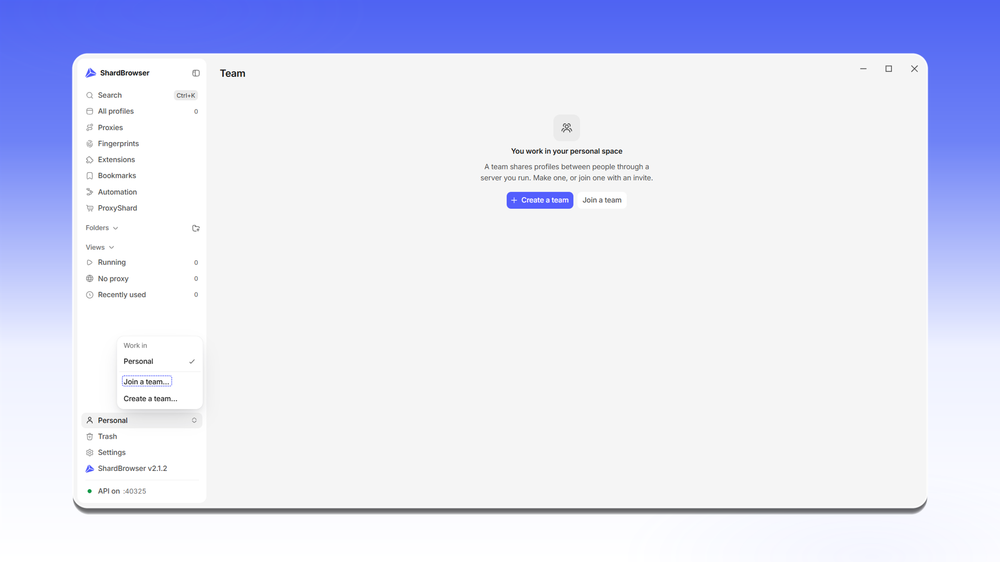
  </picture>
  <figcaption>Меню робочого простору - «Join a team...»</figcaption>
</figure>

У вікні <mark style="color:purple;">**Join a team**</mark> потрібно вставити інвайт, отриманий від адміністратора, у поле <mark style="color:purple;">**Invite or server address**</mark>. Адреса сервера й <mark style="color:purple;">**Access token**</mark> заповняться самі. Потім натисніть <mark style="color:purple;">**Join**</mark>.

<figure>
  <picture>
    <source srcset="../../.gitbook/assets/shardbrowser-team-join-dialog_black.png" media="(prefers-color-scheme: dark)">
    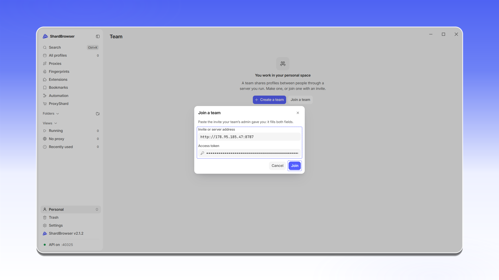
  </picture>
  <figcaption>Вставте інвайт у вікні Join a team</figcaption>
</figure>

Після підключення в меню перемикача в учасника з'являється пункт <mark style="color:purple;">**Your access**</mark>. Він показує, які права видав адміністратор. Змінити їх може лише адміністратор.

<figure>
  <picture>
    <source srcset="../../.gitbook/assets/shardbrowser-team-your-access_black.png" media="(prefers-color-scheme: dark)">
    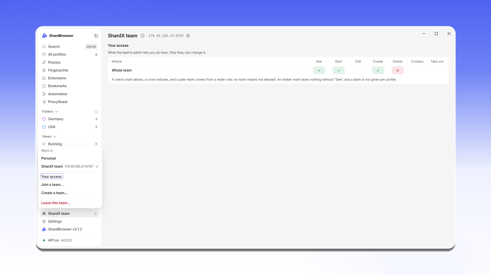
  </picture>
  <figcaption>Права учасника в розділі Your access</figcaption>
</figure>

У розділі <mark style="color:purple;">**All profiles**</mark> учасник бачить профілі команди з доступних йому папок і працює з ними в межах виданих прав. Щоб повернутися до локальних профілів, виберіть <mark style="color:purple;">**Personal**</mark> у перемикачі.

<figure>
  <picture>
    <source srcset="../../.gitbook/assets/shardbrowser-team-profiles_black.png" media="(prefers-color-scheme: dark)">
    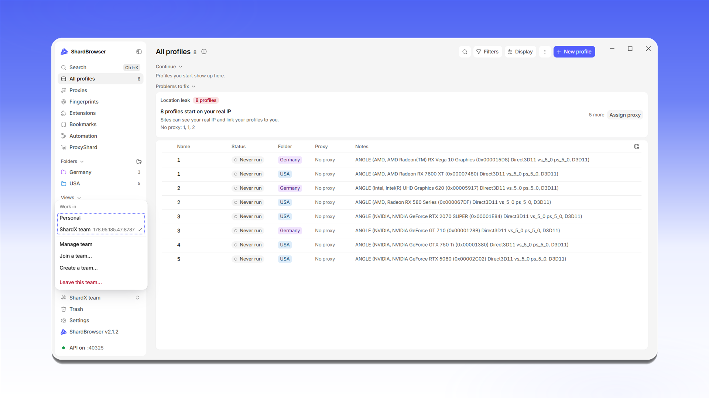
  </picture>
  <figcaption>Профілі команди в учасника</figcaption>
</figure>
