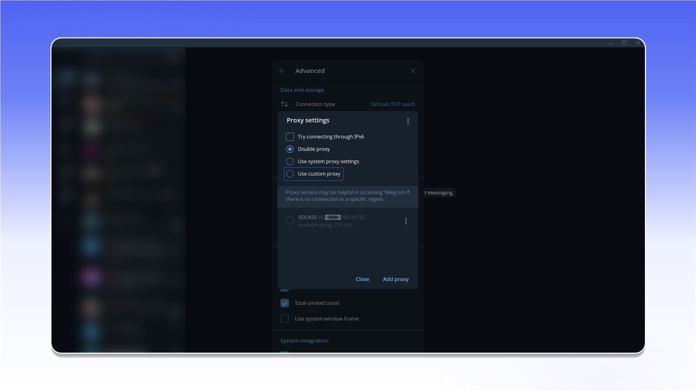

# Telegram

## Telegram Desktop

Відкрийте `Settings`.

<figure>
  <picture>
    <source srcset="../.gitbook/assets/telegram-desktop-menu-settings_black.png" media="(prefers-color-scheme: dark)">
    
  </picture>
</figure>

Перейдіть до `Advanced`.

<figure>
  <picture>
    <source srcset="../.gitbook/assets/telegram-desktop-settings-advanced_black.png" media="(prefers-color-scheme: dark)">
    
  </picture>
</figure>

У розділі `Network and proxy` відкрийте `Connection type`.

<figure>
  <picture>
    <source srcset="../.gitbook/assets/telegram-desktop-connection-type_black.png" media="(prefers-color-scheme: dark)">
    
  </picture>
</figure>

Виберіть `Use custom proxy`, натисніть `Add proxy` і вкажіть протокол. Заповніть поля адреси, порту, логіна й пароля даними з `Proxy List` вашого замовлення.


Формат даних і приклад замовлення описані в розділі [Початок роботи](getting-started.md).


<figure>
  <picture>
    <source srcset="../.gitbook/assets/telegram-desktop-use-custom-proxy_black.png" media="(prefers-color-scheme: dark)">
    
  </picture>
</figure>

Збережіть налаштування та переконайтеся, що поруч із проксі відображається статус `Connected`.

<figure>
  <picture>
    <source srcset="../.gitbook/assets/telegram-desktop-proxy-connected_black.png" media="(prefers-color-scheme: dark)">
    
  </picture>
</figure>

## Telegram для iOS

Відкрийте `Settings` і виберіть `Data and Storage`.

<figure>
  <picture>
    <source srcset="../.gitbook/assets/telegram-ios-settings-data-storage_black.png" media="(prefers-color-scheme: dark)">
    
  </picture>
</figure>

Відкрийте `Proxy`, потім натисніть `Add Proxy`.

<figure>
  <picture>
    <source srcset="../.gitbook/assets/telegram-ios-connection-proxy_black.png" media="(prefers-color-scheme: dark)">
    
  </picture>
</figure>

Виберіть `SOCKS5` і заповніть поля `Server`, `Port`, `Username` та `Password` даними з `Proxy List` вашого замовлення.

<figure>
  <picture>
    <source srcset="../.gitbook/assets/telegram-ios-proxy-socks5-form_black.png" media="(prefers-color-scheme: dark)">
    
  </picture>
</figure>

Збережіть налаштування та ввімкніть створений проксі.
