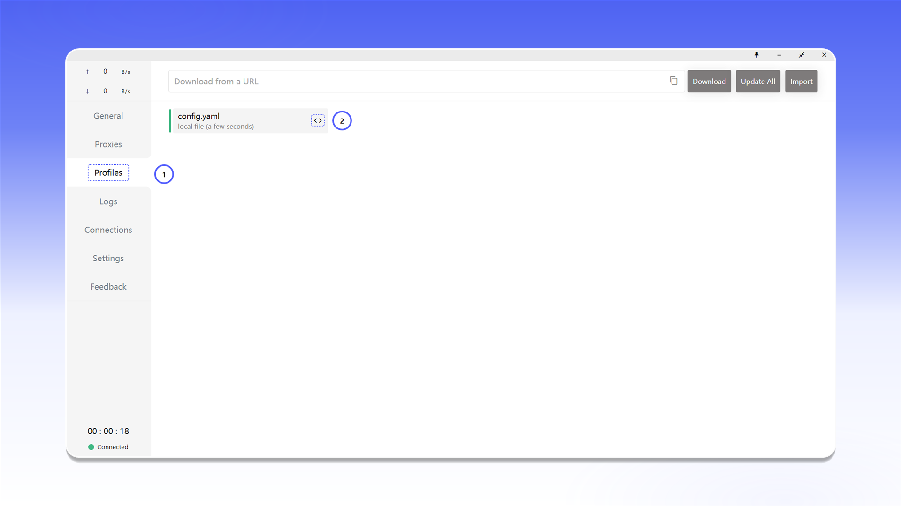
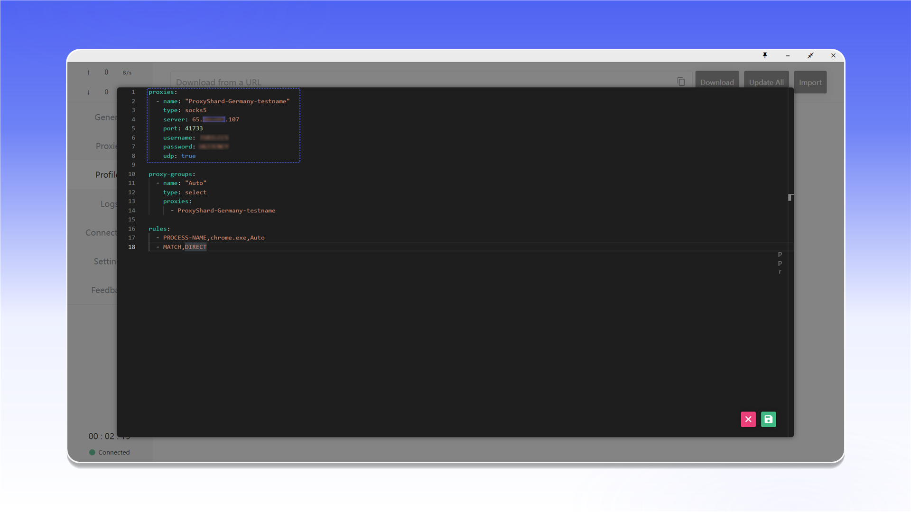
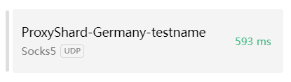

# Clash for Windows


Clash for Windows підтримує проксіювання TCP- і UDP-трафіку в режимі TUN.


## Завантаження та запуск

Відкрийте [сторінку релізів Clash for Windows](https://github.com/lantongxue/clash_for_windows_pkg/releases) і завантажте `Clash.for.Windows-0.20.39-win.7z`.

<figure>
  <picture>
    <source srcset="../../.gitbook/assets/clashx-github-download_black.png" media="(prefers-color-scheme: dark)">
    
  </picture>
</figure>

Розпакуйте архів в окрему папку.

<figure><figcaption></figcaption></figure>

Запустіть `Clash for Windows.exe` від імені адміністратора. Це потрібно для встановлення та роботи системного мережевого драйвера.

<figure><figcaption></figcaption></figure>

## Налаштування профілю

1. Відкрийте `Profiles`.
2. Натисніть значок `<>` біля `config.yaml`.

<figure>
  <picture>
    <source srcset="../../.gitbook/assets/clashx-profiles-edit-config_black.png" media="(prefers-color-scheme: dark)">
    
  </picture>
</figure>

Додайте проксі до блоку `proxies:` і введіть дані із замовлення. У прикладі використовується SOCKS5.

```yaml
proxies:
  - name: "ProxyShard-Germany"
    type: socks5
    server: 123.123.123.123
    port: 41733
    username: proxy_login
    password: proxy_password
    udp: true

proxy-groups:
  - name: "ProxyShard"
    type: select
    proxies:
      - ProxyShard-Germany

rules:
  - PROCESS-NAME,chrome.exe,ProxyShard
  - MATCH,DIRECT
```

`name` задає назву підключення. У `server`, `port`, `username` і `password` введіть дані проксі. Параметр `udp: true` вмикає UDP для цього сервера.

<figure>
  <picture>
    <source srcset="../../.gitbook/assets/clashx-profile-config-proxies_black.png" media="(prefers-color-scheme: dark)">
    
  </picture>
</figure>


Розташування даних підключення описано в [загальній інструкції](../getting-started.md).


## Активація та перевірка

1. Відкрийте `Proxies`.
2. Виберіть режим `Global`.
3. Натисніть `Check` біля сервера ProxyShard.

<figure>
  <picture>
    <source srcset="../../.gitbook/assets/clashx-proxies-global-select_black.png" media="(prefers-color-scheme: dark)">
    
  </picture>
</figure>

Якщо з'єднання доступне, на картці з'явиться час відгуку.

<figure><figcaption></figcaption></figure>

## Кілька проксі

Додайте кожен сервер окремим елементом у `proxies:` і перелічіть їхні назви в групі `ProxyShard`. Після збереження сервери з'являться в розділі `Proxies`, де між ними можна перемикатися.

<figure>
  <picture>
    <source srcset="../../.gitbook/assets/clashx-proxies-multiple-list_black.png" media="(prefers-color-scheme: dark)">
    
  </picture>
</figure>

## Увімкнення TUN Mode

1. Відкрийте `General`.
2. У рядку `TAP Device` натисніть `Manage`, потім `Install`.
3. Увімкніть `TUN Mode`, щоб спрямувати системний трафік через вибраний проксі.

<figure>
  <picture>
    <source srcset="../../.gitbook/assets/clashx-general-tap-tun-setup_black.png" media="(prefers-color-scheme: dark)">
    
  </picture>
</figure>

## Перевірка підключення

Відкрийте [ProxyShard IP Checker](https://proxyshard.com/tools/ip-checker) і переконайтеся, що відображається IP-адреса проксі.

<figure>
  <picture>
    <source srcset="../../.gitbook/assets/clashx-ip-checker-result_black.png" media="(prefers-color-scheme: dark)">
    
  </picture>
</figure>

Додатково перевірте WebRTC через BrowserLeaks.

<figure>
  <picture>
    <source srcset="../../.gitbook/assets/clashx-browserleaks-check_black.png" media="(prefers-color-scheme: dark)">
    
  </picture>
</figure>

Якщо з'єднання не працює, перевірте дані в `config.yaml`, повторно запустіть програму від імені адміністратора та скористайтеся [інструкцією з діагностики](../../faq-and-support/faq/proxy-not-working.md).
