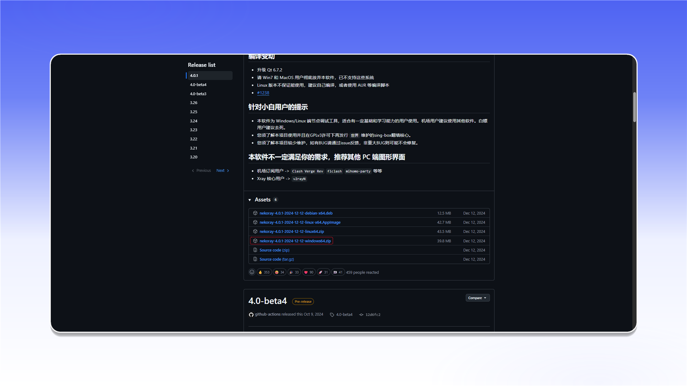
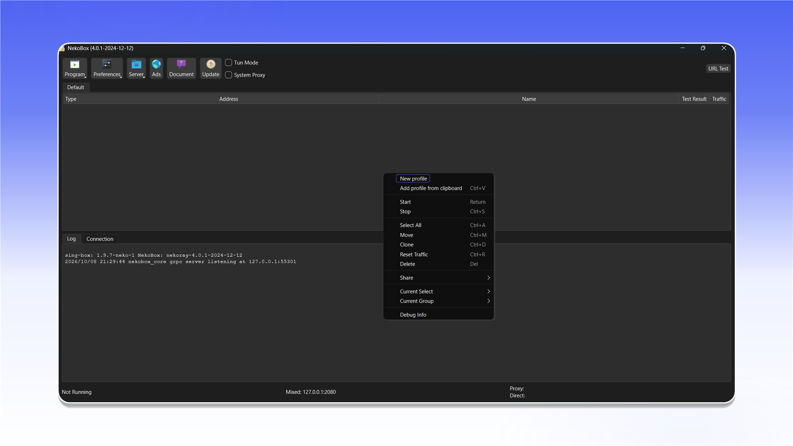

# NekoRay


NekoRay підтримує проксіювання TCP- і UDP-трафіку в режимі TUN.


## Завантаження та запуск

Завантажте архів для Windows зі [сторінки релізів NekoRay](https://github.com/MatsuriDayo/nekoray/releases), розпакуйте його та запустіть `nekoray.exe` або `nekobox.exe`. Під час першого запуску виберіть ядро `sing-box`.

<figure>
  <picture>
    <source srcset="../../.gitbook/assets/nekoray-github-download_black.png" media="(prefers-color-scheme: dark)">
    
  </picture>
</figure>

## Створення профілю

Клацніть правою кнопкою миші на порожній області списку серверів і виберіть `New profile`.

<figure>
  <picture>
    <source srcset="../../.gitbook/assets/nekoray-main-new-profile_black.png" media="(prefers-color-scheme: dark)">
    
  </picture>
</figure>

У списку `Type` виберіть `Socks`.

<figure>
  <picture>
    <source srcset="../../.gitbook/assets/nekoray-profile-type-socks_black.png" media="(prefers-color-scheme: dark)">
    
  </picture>
</figure>

Введіть дані підключення:

1. У полі `Name` задайте зрозумілу назву.
2. У `Address` і `Port` введіть адресу та порт проксі.
3. У розділі `Socks` виберіть `Version: 5`.
4. Заповніть `Username` і `Password`.
5. Натисніть `OK`.

<figure>
  <picture>
    <source srcset="../../.gitbook/assets/nekoray-profile-config_black.png" media="(prefers-color-scheme: dark)">
    
  </picture>
</figure>


Розташування даних підключення описано в [загальній інструкції](../getting-started.md).


## Підключення

Виберіть створений профіль і ввімкніть `Tun Mode` у верхній панелі. Після запуску системний трафік проходитиме через налаштований проксі.

<figure>
  <picture>
    <source srcset="../../.gitbook/assets/nekoray-tun-mode-enable_black.png" media="(prefers-color-scheme: dark)">
    
  </picture>
</figure>
