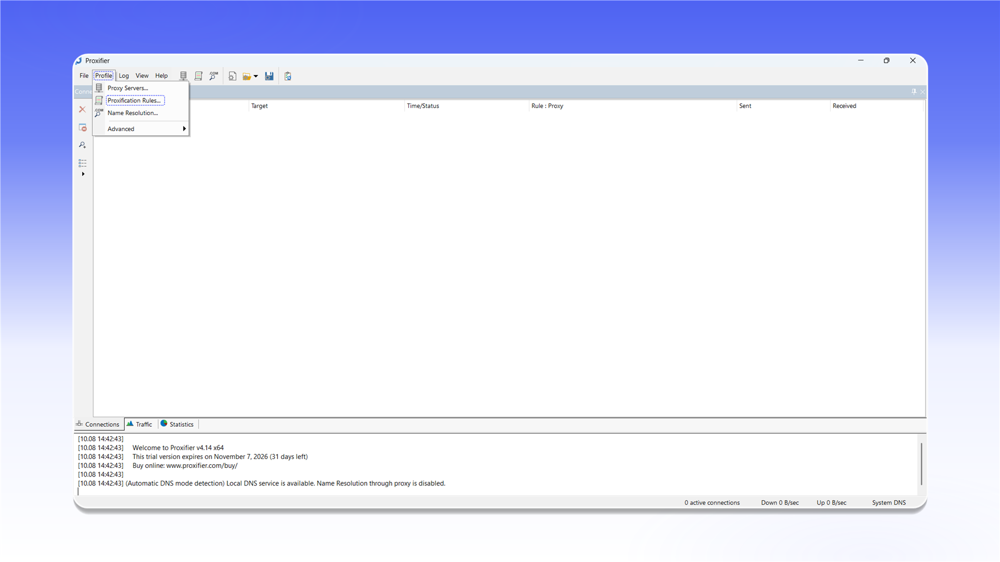

# Proxifier


Proxifier не підтримує проксіювання UDP-трафіку.



Proxifier є платною програмою. Пробний період становить 31 день.


## Встановлення

Відкрийте [сторінку завантаження Proxifier](https://www.proxifier.com/download/), завантажте `ProxifierSetup.exe` і встановіть програму.

<figure>
  <picture>
    <source srcset="../../.gitbook/assets/proxifier-website-download_black.png" media="(prefers-color-scheme: dark)">
    
  </picture>
</figure>

## Додавання проксі

1. Запустіть Proxifier.
2. Відкрийте меню `Profile` і виберіть `Proxy Servers...`.

<figure>
  <picture>
    <source srcset="../../.gitbook/assets/proxifier-menu-proxy-servers_black.png" media="(prefers-color-scheme: dark)">
    
  </picture>
</figure>

У вікні `Proxy Servers` натисніть `Add...` і заповніть форму:

- `Address`: IP-адреса або домен проксі;
- `Port`: порт підключення;
- `Protocol`: `SOCKS Version 5` або `HTTPS` для HTTP-проксі;
- `Authentication`: увімкніть `Enable`, потім введіть `Username` і `Password`.

<figure>
  <picture>
    <source srcset="../../.gitbook/assets/proxifier-add-proxy-dialog_black.png" media="(prefers-color-scheme: dark)">
    
  </picture>
</figure>


Розташування даних підключення описано в [загальній інструкції](../getting-started.md).


Натисніть `Check`. Після появи повідомлення `Proxy is ready to work with Proxifier!` закрийте вікно перевірки кнопкою `OK` і збережіть сервер.

<figure>
  <picture>
    <source srcset="../../.gitbook/assets/proxifier-proxy-check-success_black.png" media="(prefers-color-scheme: dark)">
    
  </picture>
</figure>

## Налаштування маршрутизації

Відкрийте меню `Profile` і виберіть `Proxification Rules...`.

<figure>
  <picture>
    <source srcset="../../.gitbook/assets/proxifier-menu-proxification-rules_black.png" media="(prefers-color-scheme: dark)">
    
  </picture>
</figure>

У рядку `Default` відкрийте список у стовпці `Action`, виберіть доданий SOCKS5-проксі та натисніть `OK`. Після цього трафік програм проходитиме через вибраний сервер.

<figure>
  <picture>
    <source srcset="../../.gitbook/assets/proxifier-rules-configuration_black.png" media="(prefers-color-scheme: dark)">
    
  </picture>
</figure>
