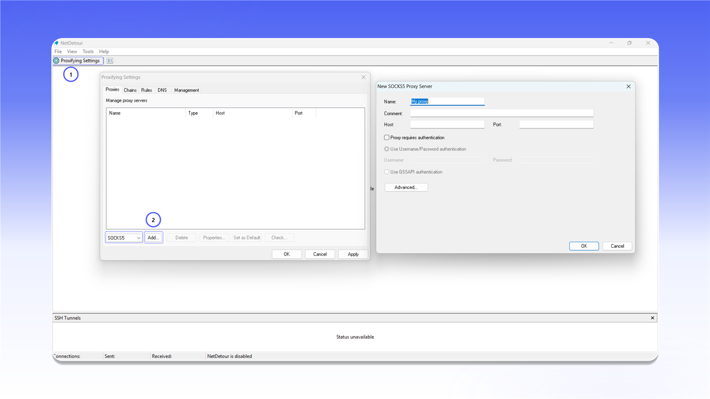

# ProxyCap (NetDetour)


NetDetour підтримує проксіювання TCP- і UDP-трафіку.



NetDetour є актуальним продовженням ProxyCap. Програма платна, пробний період становить 30 днів.


## Встановлення

Відкрийте [сторінку завантаження](https://www.proxycap.com/download.html), натисніть `Download NetDetour` і встановіть програму.

<figure>
  <picture>
    <source srcset="../../.gitbook/assets/proxycap-netdetour-website-download_black.png" media="(prefers-color-scheme: dark)">
    
  </picture>
</figure>

## Додавання проксі

1. Натисніть значок `Proxifying Settings` у верхній панелі.
2. Відкрийте вкладку `Proxies`.
3. Виберіть `SOCKS5` і натисніть `Add...`.

<figure>
  <picture>
    <source srcset="../../.gitbook/assets/proxycap-netdetour-settings-add-proxy_black.png" media="(prefers-color-scheme: dark)">
    
  </picture>
</figure>

Заповніть форму `New SOCKS5 Proxy Server`:

- `Name`: будь-яка зрозуміла назва;
- `Host`: IP-адреса або домен проксі;
- `Port`: порт підключення;
- `Proxy requires authentication`: увімкніть цей пункт;
- `Use Username/Password authentication`: введіть логін і пароль.

Натисніть `OK`, щоб зберегти сервер.

<figure>
  <picture>
    <source srcset="../../.gitbook/assets/proxycap-netdetour-proxy-server-config_black.png" media="(prefers-color-scheme: dark)">
    
  </picture>
</figure>


Розташування даних підключення описано в [загальній інструкції](../getting-started.md).


## Створення правила

1. У вікні `Proxifying Settings` відкрийте вкладку `Rules`.
2. Натисніть `New...`.
3. На кроці `Rule Action` виберіть `Tunnel through proxy`.
4. У списку `Proxy` виберіть додане підключення.
5. Натисніть `Next >`, виберіть потрібні програми або залиште правило для всіх програм, потім збережіть його.

<figure>
  <picture>
    <source srcset="../../.gitbook/assets/proxycap-netdetour-rule-action-wizard_black.png" media="(prefers-color-scheme: dark)">
    
  </picture>
</figure>
